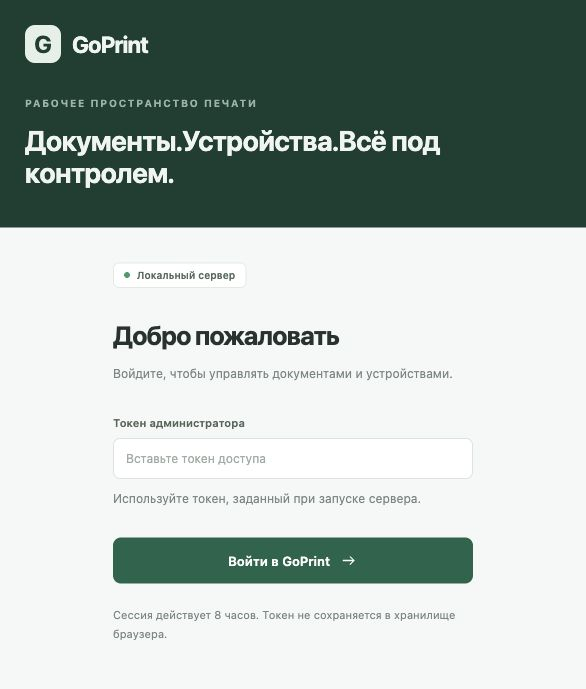
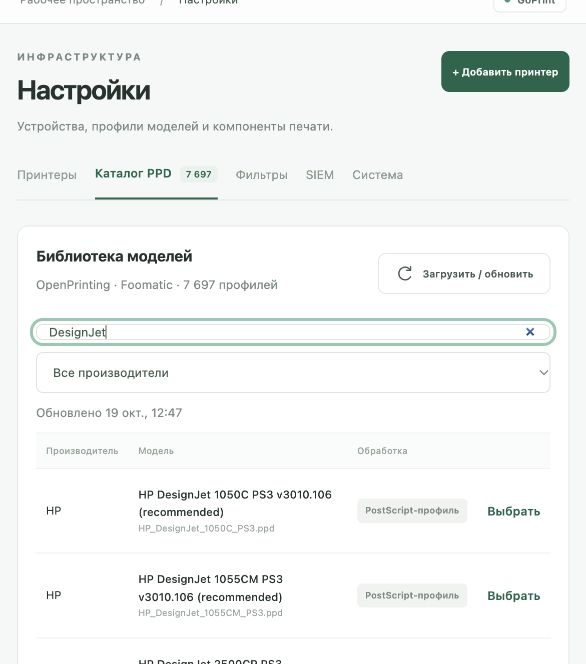
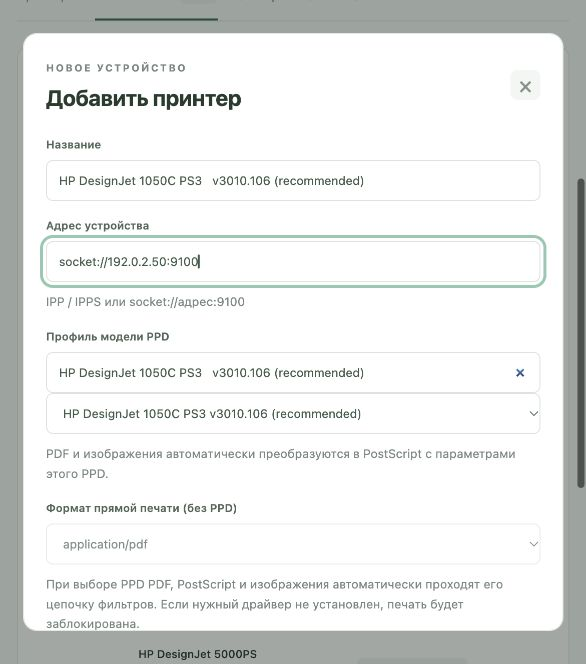
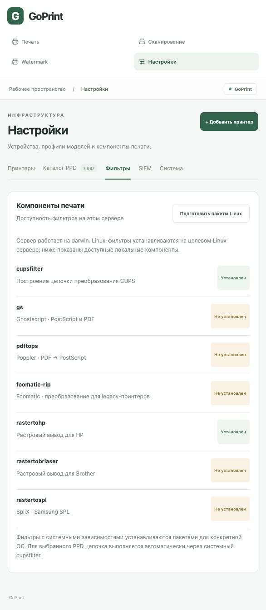
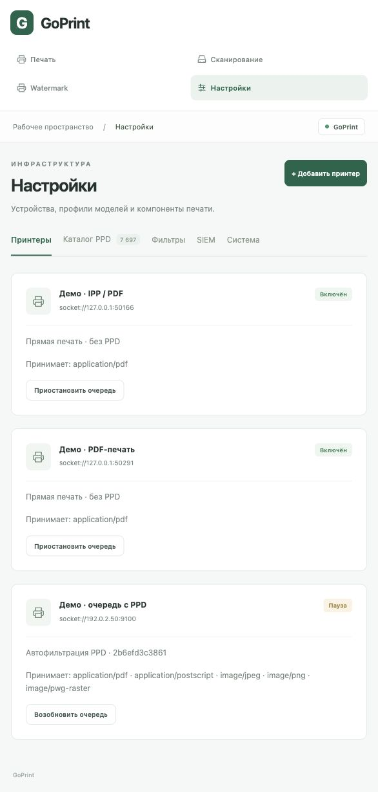
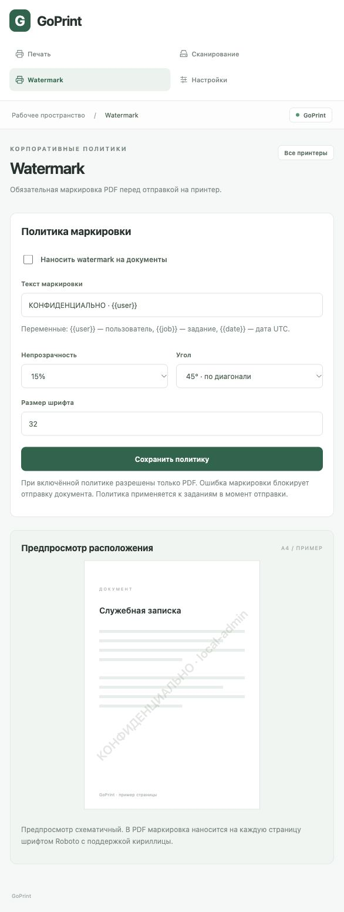
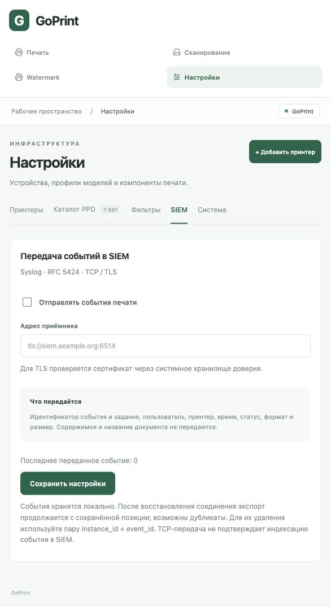
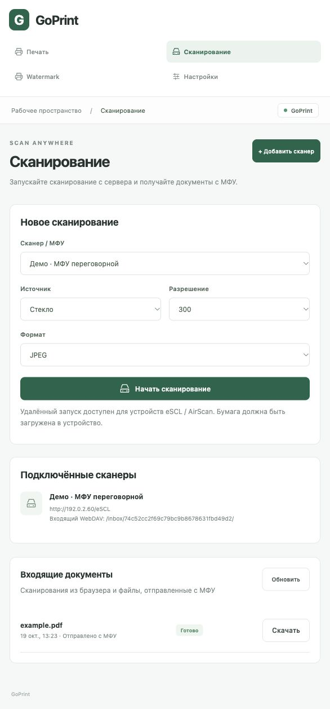

# GoPrint · Инструкция администратора

Версия v0.1.0-alpha.1 · 19 октября 2026 г.

Автор: Кислов Роман Сергеевич. Лицензия исходного кода: Apache 2.0.

Это предварительный выпуск для испытаний. Руководство описывает реализованные функции. Скриншоты сняты с отдельного демонстрационного стенда на macOS: состав фильтров на Linux будет другим. Адреса 192.0.2.x приведены как примеры; замените их адресами своих устройств. Реальные документы, токены и внутреннее ТЗ в руководство не включены.

## 1. Состав выпуска и требования

Выпуск содержит архивы Linux amd64 (x86_64) и arm64 (aarch64), три исполняемых файла, unit systemd, лицензии и руководства. Готовых DEB/RPM-пакетов нет. Go для запуска не требуется; печатные фильтры устанавливаются отдельно для архитектуры сервера.

Рекомендуемая исходная среда для испытаний — Debian/Ubuntu с systemd. Понадобятся доступ к сетевым принтерам, место для spool и сканов, а при загрузке каталога — доступ к официальному архиву OpenPrinting. Один каталог данных обслуживает один процесс goprintd.

Узнайте архитектуру: `uname -m`. Скачайте подходящий архив, SHA256SUMS и оба PDF из GitHub Releases. В каталоге загрузки выполните:

```sh
sha256sum --ignore-missing -c SHA256SUMS
tar -xzf goprint-v0.1.0-alpha.1-linux-amd64.tar.gz
cd goprint-v0.1.0-alpha.1-linux-amd64
./goprintd -version
```

Для arm64 замените имя архива и каталога. Контрольная сумма выявляет повреждение файла; отдельной криптографической подписи выпуска пока нет. Сохраняйте LICENSE, NOTICE и third_party при распространении.

GoPrint ведёт собственную очередь; системный cupsfilter используется только для преобразования. Не добавляйте эти же задания во вторую очередь CUPS. Наличие PPD не гарантирует совместимость конкретного устройства: начните с тестовой страницы.

## 2. Установка службы

Команды выполняются из распакованного каталога. Учётная запись goprint должна быть непривилегированной. Если она уже существует, повторно создавать её не нужно.

```sh
sudo apt update
sudo apt install cups cups-filters ghostscript poppler-utils
sudo useradd --system --user-group --home-dir /var/lib/goprint \
  --shell /usr/sbin/nologin goprint
sudo install -m 0755 goprintd goprintctl goprint-ppds /usr/local/bin/
sudo install -d -m 0700 -o goprint -g goprint /var/lib/goprint
sudo install -d -m 0755 /etc/goprint
sudo sh -c 'umask 077; printf "GOPRINT_TOKEN=%s\n" \
  "$(openssl rand -hex 32)" > /etc/goprint/environment'
sudo install -m 0644 packaging/goprint.service /etc/systemd/system/
sudo systemctl daemon-reload
sudo systemctl enable --now goprint
sudo systemctl status goprint
sudo journalctl -u goprint -n 50 --no-pager
```

Токен создаётся один раз. Не запускайте команду его генерации при каждом обновлении. Файл окружения должен принадлежать root и иметь права 0600. Токен длиной не менее 32 байт используется для входа в веб-консоль и API. Передавайте его только уполномоченным операторам по защищённому каналу.

PPD-фильтрация от root блокируется. Если в журнале появляется соответствующая ошибка, проверьте User=goprint в unit-файле. Дополнительные драйверы (например, foomatic-rip, brlaser, SpliX) устанавливаются из доверенных пакетов вашей ОС по требованиям конкретного PPD.

## 3. Первый вход и сетевой доступ

По умолчанию служба доступна только на самом сервере: http://127.0.0.1:8631. Для удалённого администратора можно использовать SSH-туннель:

```sh
ssh -L 8631:127.0.0.1:8631 admin@print-server
```

После этого откройте локальный адрес в браузере. Введите значение GOPRINT_TOKEN из файла окружения, без имени переменной. Сессия действует 8 часов; используется HttpOnly cookie с SameSite=Strict. При ошибке входа проверьте правильность токена, адрес сервера и перезапуск службы после изменения окружения.



Для доступа пользователей и МФУ по сети настройте сертификат с корректным DNS-именем и доверенной цепочкой. Создайте override: `sudo systemctl edit goprint`, сбросьте ExecStart пустой строкой и задайте новый:

```ini
[Service]
ExecStart=
ExecStart=/usr/local/bin/goprintd -data /var/lib/goprint -listen 0.0.0.0:8631 -tls-cert /etc/goprint/server.crt -tls-key /etc/goprint/server.key
```

Сделайте ключ читаемым пользователю goprint, сохраняя ограниченные права. Выполните daemon-reload и restart. Разрешите вход на 8631 только из нужных сетей. Без TLS сервер откажется слушать нелокальный адрес. Не обходите предупреждения браузера о сертификате: исправьте доверие и имя. Для WebDAV МФУ требуется прямой сетевой доступ к HTTPS-серверу; SSH-туннеля администратора недостаточно.

## 4. Каталог PPD

Откройте «Настройки → Каталог PPD». На первом запуске каталог загружается в фоне. Можно обновить его вручную, искать модель и отфильтровать производителя. Во время обновления прежний каталог остаётся доступным. Число 7 697 на иллюстрации относится к демонстрационному снимку набора и может измениться.



Каталог охватывает PPD-файлы из OpenPrinting foomatic-db. Он не содержит всех когда-либо выпущенных моделей, XML-генерируемых профилей и закрытых драйверов. Если поиск ничего не нашёл, проверьте название и доступность модели в исходном наборе. Не выбирайте похожую модель без проверки языка печати.

Каталог, исходный архив, контрольная сумма и лицензии хранятся в ppds внутри каталога данных. Для офлайн-импорта остановите службу, передайте ранее загруженный официальный архив и выполните:

```sh
sudo systemctl stop goprint
sudo -u goprint goprint-ppds -dir /var/lib/goprint/ppds \
  -archive /path/readable-by-goprint/foomatic-db.tar.gz
sudo systemctl start goprint
```

Флаг `-preload-ppds=false` отключает автоматическую загрузку на старте. PPD и драйверы сохраняют исходные лицензии правообладателей.

## 5. Добавление принтера

В каталоге нажмите «Выбрать» у точной модели. Либо откройте «Настройки → Добавить принтер» и найдите профиль в форме. Укажите понятное название и URI устройства: ipp://host:631/ipp/print, ipps://host:631/ipp/print либо socket://host:9100.



Нажмите «Добавить принтер». С PPD сервер принимает PDF, PostScript, JPEG, PNG и PWG Raster; возможность конкретного преобразования зависит от системных фильтров. При отсутствии цепочки задание завершится ошибкой до подключения к принтеру. MIME-тип должен соответствовать реальному содержимому.

Для прямой печати выберите «Без PPD» и формат, который устройство принимает само. Прямая передача PDF допустима только на PDF-совместимое устройство. RAW используется только для заранее подготовленных данных, без PPD. Для IPPS сертификат проверяется системным хранилищем доверия; логин и пароль в URI не поддерживаются.

Бумага и дуплекс пока берутся из значений по умолчанию PPD. Отдельной формы их выбора и редактирования уже созданного принтера нет. Перед внедрением проверьте формат бумаги, ориентацию, кириллицу и несколько страниц на физическом устройстве.

## 6. Фильтры и контрольная печать

В «Настройки → Фильтры» проверьте cupsfilter и компоненты для выбранного PPD. Скриншот показывает macOS; отсутствие gs на нём не является примером готовой Linux-конфигурации.



Кнопка «Подготовить пакеты Linux» на Debian/Ubuntu скачивает пакеты в filters внутри каталога данных. Она не устанавливает их и не разрешает все зависимости. Установку выполняет администратор через пакетный менеджер ОС; предпочтительно использовать обычный apt install с нужными пакетами.

Цепочка отправки: исходный spool → watermark, если включён → cupsfilter с проверенным PPD → IPP/IPPS или Socket. В журнале задания записываются ID PPD, имена фильтров, выходной MIME-тип и размер. Оригинал остаётся неизменным. Лимит результата по умолчанию 512 МиБ, время фильтрации — 90 секунд; лимит размера задаётся `-filter-output-mib` от 1 до 4096.

Загрузите небольшой PDF через «Печать». Проверьте журнал событий через CLI и результат на бумаге. При ошибке нет автоматической отправки исходного файла в обход фильтров. Проверка автоматического преобразования выполнена с системным CUPS и тестовым IPP-приёмником; это не заменяет испытания конкретной модели.

## 7. Управление очередью

В «Настройки → Принтеры» можно приостановить и возобновить очередь. Пауза блокирует новые отправки и не прерывает текущую. Документы продолжают приниматься в ожидание. Отмена возможна только в состоянии «В очереди».



Состояния: queued — ожидает; processing — подготовка или отправка; submitted («Передано») — приём устройством без подтверждения выхода бумаги; failed — ошибка; unknown («Проверьте устройство») — неоднозначный результат; canceled — отменено. После аварийного перезапуска незавершённые processing становятся unknown. Автоматического повтора нет: сначала проверьте устройство, чтобы избежать дубликата.

CLI использует GOPRINT_TOKEN из окружения. Флаги указываются до команды. Не передавайте токен в аргументах командной строки и не публикуйте его в диагностике.

```sh
goprintctl printers
goprintctl jobs
goprintctl job JOB_ID
goprintctl events JOB_ID
goprintctl pause PRINTER_ID
goprintctl resume PRINTER_ID
goprintctl cancel JOB_ID
```

Для CLI на другом компьютере задайте `-addr https://print.example.org:8631` перед командой. Все операции в этой версии выполняются от local-admin; изолированных пользовательских очередей и ролей пока нет.

## 8. Watermark

Откройте отдельный раздел «Watermark». Включите политику, задайте текст, непрозрачность, угол и размер шрифта, затем нажмите «Сохранить политику».



Доступны переменные {{user}}, {{job}}, {{date}}. Дата формируется в UTC. Сейчас пользователь — local-admin. Маркировка наносится на каждую страницу PDF до PPD-преобразования; используется Roboto с кириллицей. Предпросмотр показывает расположение схематично: проверьте итоговую страницу на тестовом устройстве.

Включённая политика разрешает только PDF. Ошибка watermark блокирует отправку. Политика выбирается в момент обработки задания, поэтому изменение затронет ещё ожидающие документы. Версия применённой политики записывается в события. Пользователь не может отключить маркировку для одного задания, но текущая общая администраторская учётная запись имеет доступ к её настройке.

## 9. Экспорт событий в SIEM

Откройте «Настройки → SIEM». Подготовьте приёмник Syslog RFC 5424 с RFC 6587 octet-counting, укажите адрес, включите отправку и сохраните. Для корпоративной сети используйте tls://siem.example.org:6514; TCP без шифрования также поддерживается.



TLS проверяет сертификат через системное хранилище. В события входят instance_id, event_id, job_id, пользователь, принтер, время, состояние, MIME-тип, размер и техническая причина. Содержимое и название документа не передаются. Успешная запись в TCP/TLS означает передачу в соединение, а не подтверждение индексации в SIEM.

При недоступности приёмника события остаются в локальной SQLite, затем экспорт продолжается с сохранённой позиции. Возможны дубликаты: удаляйте их по паре instance_id + event_id. Позиция общая: смена адреса не запускает весь исторический экспорт заново. Это не защищённый от изменения журнал.

Проверка: отправьте тестовый документ, дождитесь изменения последнего переданного event_id, затем найдите это событие на стороне SIEM. Проверяйте и ошибочные задания. Контролируйте состояние экспорта и рост локального хранилища.

## 10. Сканирование и Scan Anywhere

В разделе «Сканирование» нажмите «Добавить сканер», задайте название и адрес eSCL, например http://device/eSCL. Автоматического поиска и WSD пока нет. Поддерживаются ручная регистрация eSCL/AirScan и входящий WebDAV.



Сценарий из браузера: пользователь загружает бумагу в МФУ, выбирает стекло или автоподатчик, 150/300/600 dpi и JPEG/PDF. Запрос рассчитан на A4 RGB; совместимость зависит от устройства. До 99 страниц, 100 МиБ и 3 минут на сканирование; несколько полученных файлов скачиваются ZIP-архивом.

Сценарий с панели МФУ: после добавления сканера показываются URL /inbox/ID/, имя пользователя ID и отдельный пароль устройства. Сохраните их в защищённом месте сразу: пароль отображается один раз, в хранилище остаётся только хеш. Настройте на МФУ HTTPS WebDAV с этими данными, затем отправьте пробный файл. Inbox предназначен только для загрузки и не позволяет МФУ читать чужие документы. Поддержка конкретного WebDAV-клиента зависит от модели. SMB-папки не реализованы.

Если пароль утрачен, существующего экрана его просмотра или сброса нет. Ограничьте распространение этой предварительной версии, пока не проверен процесс регистрации устройств в вашей среде.

## 11. Резервное копирование, обновление и диагностика

Документы, сканы и события сохраняются без автоматической очистки. Дисковой квоты нет: контролируйте свободное место, объём каталогов и доступ к резервным копиям. Для согласованной копии остановите службу и скопируйте весь /var/lib/goprint вместе с правами. Отдельно сохраните /etc/goprint и override systemd; они содержат секреты и должны храниться защищённо.

```sh
sudo systemctl stop goprint
sudo tar -czf /secure-backup/goprint-data.tar.gz -C /var/lib goprint
sudo systemctl start goprint
```

Каталог /secure-backup должен существовать и быть доступен только администратору. Для восстановления остановите службу, восстановите весь каталог и владельца goprint:goprint, затем запустите её. Копирование только SQLite без spool и сканов недостаточно.

Перед обновлением сделайте копию, остановите службу, замените бинарники из проверенного архива и запустите службу. Сохраните прежние бинарники; откат данных выполняется из согласованной копии, если формат хранилища изменится. Не запускайте одновременно две версии с одним каталогом.

Диагностика: journalctl -u goprint; события задания через goprintctl events; вкладка «Фильтры»; адрес и доступность устройства; права на каталог; место на диске. Для unknown сначала проверьте очередь принтера. При HTTP 415 проверьте MIME-тип, профиль и включённую политику watermark. При 401 заново войдите с действующим токеном. Не включайте токены и реальные документы в публичные отчёты.

Пока отсутствуют доменная авторизация, разграничение ролей, входящий IPP, Samba/USB, подтверждение физической печати, автоматические повторы и очистка. Полноценное внедрение требует проверки этих ограничений относительно требований вашей организации.
