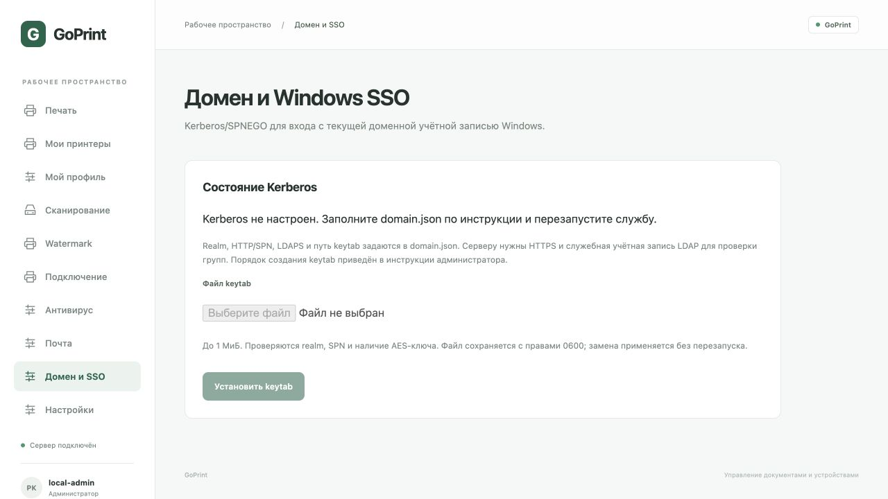
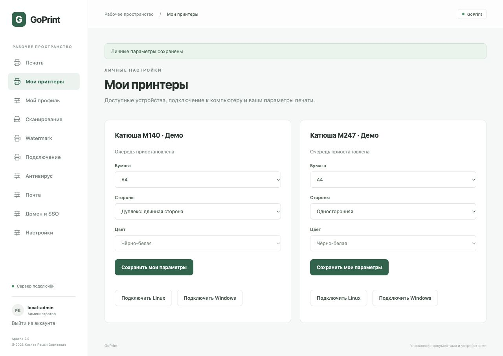
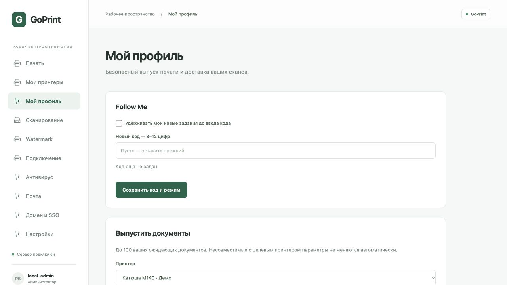
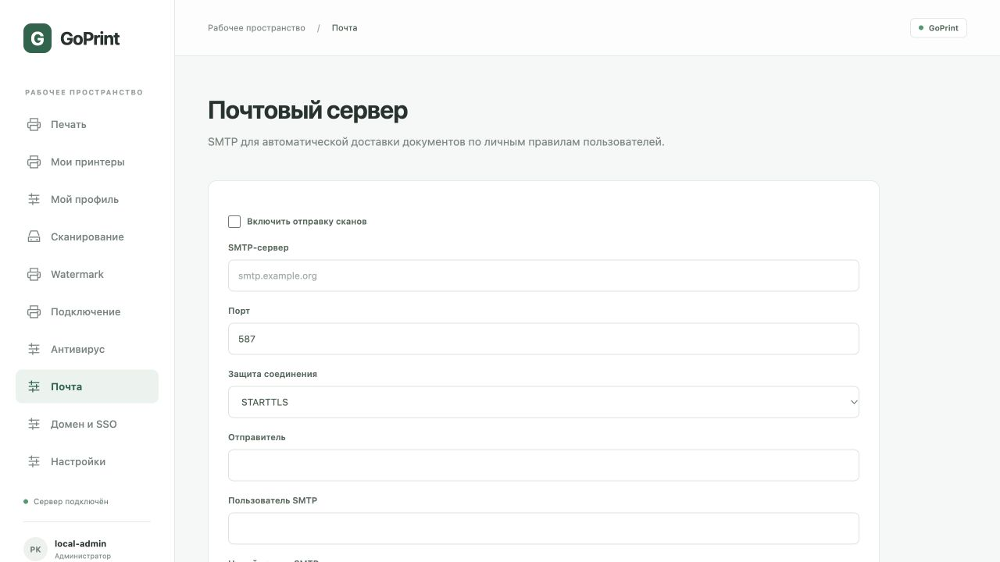
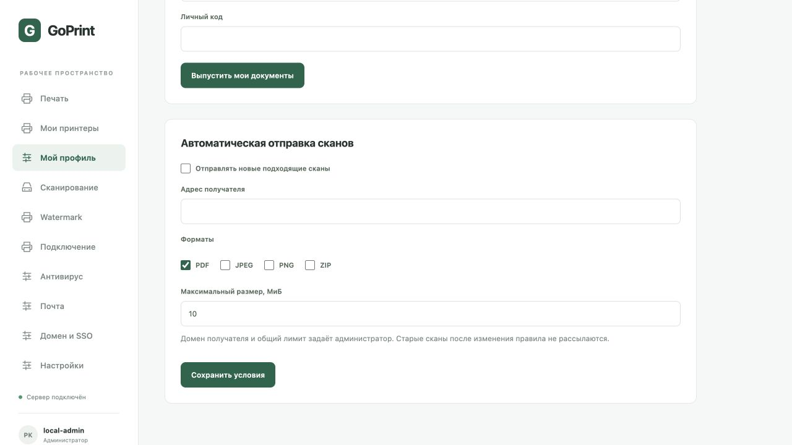
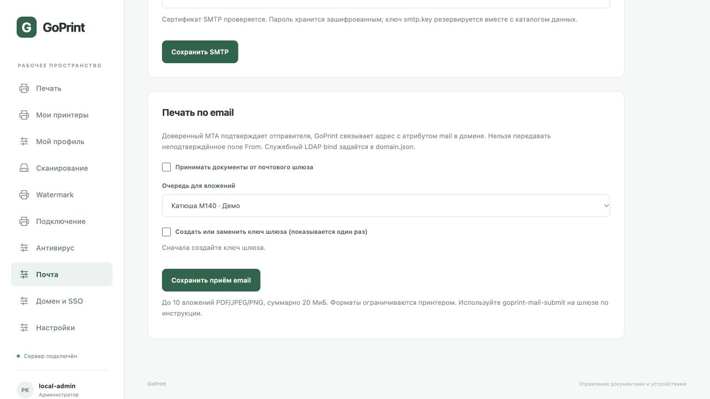
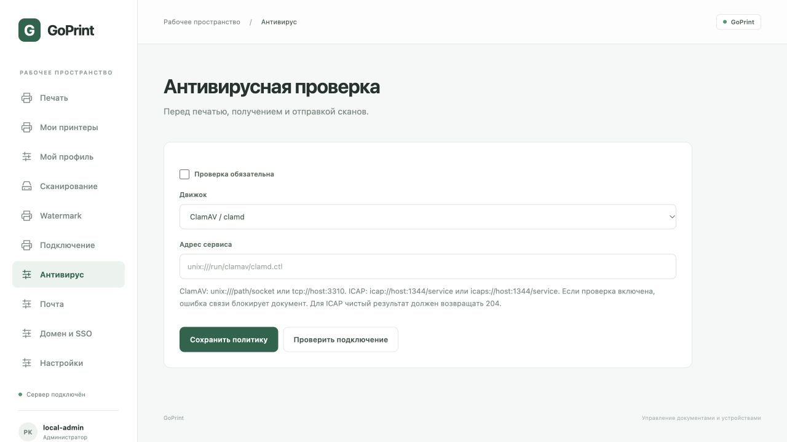

# GoPrint · Инструкция администратора

Версия v0.2.0-beta.1 · 19 октября 2026 г.

Автор: Кислов Роман Сергеевич. Лицензия исходного кода: Apache 2.0.

Это предварительный выпуск для испытаний. Руководство описывает реализованные функции. Скриншоты сняты с отдельного демонстрационного стенда на macOS: состав фильтров на Linux будет другим. Адреса 192.0.2.x приведены как примеры; замените их адресами своих устройств. Реальные документы, токены и внутреннее ТЗ в руководство не включены.

## 1. Состав выпуска и требования

Выпуск содержит архивы Linux amd64 (x86_64) и arm64 (aarch64), пять исполняемых файлов: goprintd, goprintctl, goprint-ppds, goprint-migrate и goprint-mail-submit, unit systemd, лицензии и руководства. Готовых DEB/RPM-пакетов нет. Go для запуска не требуется; печатные фильтры устанавливаются отдельно для архитектуры сервера.

Рекомендуемая исходная среда для испытаний — Debian/Ubuntu с systemd. Понадобятся доступ к сетевым принтерам, место для spool и сканов, а при загрузке каталога — доступ к официальному архиву OpenPrinting. Один каталог данных обслуживает один процесс goprintd.

Узнайте архитектуру: `uname -m`. Скачайте подходящий архив, SHA256SUMS и оба PDF из GitHub Releases. В каталоге загрузки выполните:

```sh
sha256sum --ignore-missing -c SHA256SUMS
tar -xzf goprint-v0.2.0-beta.1-linux-amd64.tar.gz
cd goprint-v0.2.0-beta.1-linux-amd64
./goprintd -version
```

Для arm64 замените имя архива и каталога. Контрольная сумма выявляет повреждение файла; отдельной криптографической подписи выпуска пока нет. Сохраняйте LICENSE, NOTICE и third_party при распространении.

GoPrint ведёт собственную очередь; системный cupsfilter используется только для преобразования. Не добавляйте эти же задания во вторую очередь CUPS. Наличие PPD не гарантирует совместимость конкретного устройства: начните с тестовой страницы.

## 2. Установка службы

Команды выполняются из распакованного каталога. Учётная запись goprint должна быть непривилегированной. Если она уже существует, повторно создавать её не нужно.

```sh
sudo apt update
sudo apt install cups cups-filters ghostscript poppler-utils
sudo useradd --system --user-group --home-dir /var/lib/goprint \
  --shell /usr/sbin/nologin goprint
sudo install -m 0755 goprintd goprintctl goprint-ppds goprint-migrate goprint-mail-submit /usr/local/bin/
sudo install -d -m 0700 -o goprint -g goprint /var/lib/goprint
sudo install -d -m 0755 /etc/goprint
sudo sh -c 'umask 077; printf "GOPRINT_TOKEN=%s\n" \
  "$(openssl rand -hex 32)" > /etc/goprint/environment'
sudo install -m 0644 packaging/goprint.service /etc/systemd/system/
sudo systemctl daemon-reload
sudo systemctl enable --now goprint
sudo systemctl status goprint
sudo journalctl -u goprint -n 50 --no-pager
```

Токен создаётся один раз. Не запускайте команду его генерации при каждом обновлении. Файл окружения должен принадлежать root и иметь права 0600. Токен длиной не менее 32 байт используется для входа в веб-консоль и API. Передавайте его только уполномоченным операторам по защищённому каналу.

PPD-фильтрация от root блокируется. Если в журнале появляется соответствующая ошибка, проверьте User=goprint в unit-файле. Дополнительные драйверы (например, foomatic-rip, brlaser, SpliX) устанавливаются из доверенных пакетов вашей ОС по требованиям конкретного PPD.

## 3. Первый вход и сетевой доступ

По умолчанию служба доступна только на самом сервере: http://127.0.0.1:8631. Для удалённого администратора можно использовать SSH-туннель:

```sh
ssh -L 8631:127.0.0.1:8631 admin@print-server
```

После этого откройте локальный адрес в браузере. Введите значение GOPRINT_TOKEN из файла окружения, без имени переменной. Сессия действует 8 часов; используется HttpOnly cookie с SameSite=Strict. При ошибке входа проверьте правильность токена, адрес сервера и перезапуск службы после изменения окружения.


Для доступа пользователей и МФУ по сети настройте сертификат с корректным DNS-именем и доверенной цепочкой. Создайте override: `sudo systemctl edit goprint`, сбросьте ExecStart пустой строкой и задайте новый:

```ini
[Service]
ExecStart=
ExecStart=/usr/local/bin/goprintd -data /var/lib/goprint -listen 0.0.0.0:8631 -tls-cert /etc/goprint/server.crt -tls-key /etc/goprint/server.key
```

Сделайте ключ читаемым пользователю goprint, сохраняя ограниченные права. Выполните daemon-reload и restart. Разрешите вход на 8631 только из нужных сетей. Без TLS сервер откажется слушать нелокальный адрес. Не обходите предупреждения браузера о сертификате: исправьте доверие и имя. Для WebDAV МФУ требуется прямой сетевой доступ к HTTPS-серверу; SSH-туннеля администратора недостаточно.

## 4. Каталог PPD

Откройте «Настройки → Каталог PPD». На первом запуске каталог загружается в фоне. Можно обновить его вручную, искать модель и отфильтровать производителя. Во время обновления прежний каталог остаётся доступным. Число 7 697 на иллюстрации относится к демонстрационному снимку набора и может измениться.


Каталог охватывает PPD-файлы из OpenPrinting foomatic-db. Он не содержит всех когда-либо выпущенных моделей, XML-генерируемых профилей и закрытых драйверов. Если поиск ничего не нашёл, проверьте название и доступность модели в исходном наборе. Не выбирайте похожую модель без проверки языка печати.

Каталог, исходный архив, контрольная сумма и лицензии хранятся в ppds внутри каталога данных. Для офлайн-импорта остановите службу, передайте ранее загруженный официальный архив и выполните:

```sh
sudo systemctl stop goprint
sudo -u goprint goprint-ppds -dir /var/lib/goprint/ppds \
  -archive /path/readable-by-goprint/foomatic-db.tar.gz
sudo systemctl start goprint
```

Флаг `-preload-ppds=false` отключает автоматическую загрузку на старте. PPD и драйверы сохраняют исходные лицензии правообладателей.

## 5. Добавление принтера

В каталоге нажмите «Выбрать» у точной модели. Либо откройте «Настройки → Добавить принтер» и найдите профиль в форме. Укажите понятное название и URI устройства: ipp://host:631/ipp/print, ipps://host:631/ipp/print либо socket://host:9100.


Нажмите «Добавить принтер». С PPD сервер принимает PDF, PostScript, JPEG, PNG и PWG Raster; возможность конкретного преобразования зависит от системных фильтров. При отсутствии цепочки задание завершится ошибкой до подключения к принтеру. MIME-тип должен соответствовать реальному содержимому.

Для прямой печати выберите «Без PPD» и формат, который устройство принимает само. Прямая передача PDF допустима только на PDF-совместимое устройство. RAW используется только для заранее подготовленных данных, без PPD. Для IPPS сертификат проверяется системным хранилищем доверия; логин и пароль в URI не поддерживаются.

Пользователь выбирает поддерживаемые бумагу, дуплекс и цвет в «Мои принтеры». Общие URI/PPD меняет администратор; отдельного редактирования уже созданного устройства пока нет. Перед внедрением проверьте формат бумаги, ориентацию, кириллицу и несколько страниц на физическом устройстве.

## 6. Фильтры и контрольная печать

В «Настройки → Фильтры» проверьте cupsfilter и компоненты для выбранного PPD. Скриншот показывает macOS; отсутствие gs на нём не является примером готовой Linux-конфигурации.


Кнопка «Подготовить пакеты Linux» на Debian/Ubuntu скачивает пакеты в filters внутри каталога данных. Она не устанавливает их и не разрешает все зависимости. Установку выполняет администратор через пакетный менеджер ОС; предпочтительно использовать обычный apt install с нужными пакетами.

Цепочка отправки: исходный spool → watermark, если включён → cupsfilter с проверенным PPD → IPP/IPPS или Socket. В журнале задания записываются ID PPD, имена фильтров, выходной MIME-тип и размер. Оригинал остаётся неизменным. Лимит результата по умолчанию 512 МиБ, время фильтрации — 90 секунд; лимит размера задаётся `-filter-output-mib` от 1 до 4096.

Загрузите небольшой PDF через «Печать». Проверьте журнал событий через CLI и результат на бумаге. При ошибке нет автоматической отправки исходного файла в обход фильтров. Проверка автоматического преобразования выполнена с системным CUPS и тестовым IPP-приёмником; это не заменяет испытания конкретной модели.

## 7. Управление очередью

В «Настройки → Принтеры» можно приостановить и возобновить очередь. Пауза блокирует новые отправки и не прерывает текущую. Документы продолжают приниматься в ожидание. Отмена возможна до начала обработки: «В очереди», «Ожидает документ» или «Ожидает выпуска».


Состояние held-release («Ожидает выпуска») означает удержание Follow Me; эти документы можно отменить или выпустить своим кодом. Состояния: queued — ожидает; processing — подготовка или отправка; submitted («Передано») — приём устройством без подтверждения выхода бумаги; failed — ошибка; unknown («Проверьте устройство») — неоднозначный результат; canceled — отменено. После аварийного перезапуска незавершённые processing становятся unknown. Автоматического повтора нет: сначала проверьте устройство, чтобы избежать дубликата.

CLI использует GOPRINT_TOKEN из окружения. Флаги указываются до команды. Не передавайте токен в аргументах командной строки и не публикуйте его в диагностике.

```sh
goprintctl printers
goprintctl jobs
goprintctl job JOB_ID
goprintctl events JOB_ID
goprintctl pause PRINTER_ID
goprintctl resume PRINTER_ID
goprintctl cancel JOB_ID
```

Для CLI на другом компьютере задайте `-addr https://print.example.org:8631` перед командой. CLI рассчитан на администратора и использует локальный токен. В браузере доменные пользователи видят свои задания, администратор — все. Настройка домена описана далее.

## 8. Watermark

Откройте отдельный раздел «Watermark». Включите политику, задайте текст, непрозрачность, угол и размер шрифта, затем нажмите «Сохранить политику».


Доступны переменные {{user}}, {{job}}, {{date}}. Дата формируется в UTC. Для доменного входа используется подтверждённый UPN; при локальном административном входе — local-admin. Маркировка наносится на каждую страницу PDF до PPD-преобразования; используется Roboto с кириллицей. Предпросмотр показывает расположение схематично: проверьте итоговую страницу на тестовом устройстве.

Включённая политика разрешает только PDF. Ошибка watermark блокирует отправку. Политика выбирается в момент обработки задания, поэтому изменение затронет ещё ожидающие документы. Версия применённой политики записывается в события. Пользователь не может отключить маркировку для одного задания, изменять политику может администратор.

## 9. Экспорт событий в SIEM

Откройте «Настройки → SIEM». Подготовьте приёмник Syslog RFC 5424 с RFC 6587 octet-counting, укажите адрес, включите отправку и сохраните. Для корпоративной сети используйте tls://siem.example.org:6514; TCP без шифрования также поддерживается.


TLS проверяет сертификат через системное хранилище. В события входят instance_id, event_id, job_id, пользователь, принтер, время, состояние, MIME-тип, размер и техническая причина. Содержимое и название документа не передаются. Успешная запись в TCP/TLS означает передачу в соединение, а не подтверждение индексации в SIEM.

При недоступности приёмника события остаются в настроенной базе SQLite или PostgreSQL, затем экспорт продолжается с сохранённой позиции. Возможны дубликаты: удаляйте их по паре instance_id + event_id. Позиция общая: смена адреса не запускает весь исторический экспорт заново. Это не защищённый от изменения журнал.

Проверка: отправьте тестовый документ, дождитесь изменения последнего переданного event_id, затем найдите это событие на стороне SIEM. Проверяйте и ошибочные задания. Контролируйте состояние экспорта и рост локального хранилища.

## 10. Сканирование и Scan Anywhere

В разделе «Сканирование» нажмите «Добавить сканер», задайте название и адрес eSCL, например http://device/eSCL. Автоматического поиска и WSD пока нет. Поддерживаются ручная регистрация eSCL/AirScan и входящий WebDAV.


Сценарий из браузера: пользователь загружает бумагу в МФУ, выбирает стекло или автоподатчик, 150/300/600 dpi и JPEG/PDF. Запрос рассчитан на A4 RGB; совместимость зависит от устройства. До 99 страниц, 100 МиБ и 3 минут на сканирование; несколько полученных файлов скачиваются ZIP-архивом.

Сценарий с панели МФУ: после добавления сканера показываются URL /inbox/ID/, имя пользователя ID и отдельный пароль устройства. Сохраните их в защищённом месте сразу: пароль отображается один раз, в хранилище остаётся только хеш. Настройте на МФУ HTTPS WebDAV с этими данными, затем отправьте пробный файл. Inbox предназначен только для загрузки и не позволяет МФУ читать чужие документы. Поддержка конкретного WebDAV-клиента зависит от модели. SMB-папки не реализованы.

Если пароль утрачен, существующего экрана его просмотра или сброса нет. Ограничьте распространение этой предварительной версии, пока не проверен процесс регистрации устройств в вашей среде.

## 11. Резервное копирование, обновление и диагностика

Документы, сканы и события сохраняются без автоматической очистки. Дисковой квоты нет: контролируйте свободное место, объём каталогов и доступ к резервным копиям. Для согласованной копии остановите службу и скопируйте весь /var/lib/goprint вместе с правами. Отдельно сохраните /etc/goprint и override systemd; они содержат секреты и должны храниться защищённо.

```sh
sudo systemctl stop goprint
sudo tar -czf /secure-backup/goprint-data.tar.gz -C /var/lib goprint
sudo systemctl start goprint
```

Каталог /secure-backup должен существовать и быть доступен только администратору. Для восстановления остановите службу, восстановите весь каталог и владельца goprint:goprint, затем запустите её. Копирование только SQLite без spool и сканов недостаточно.

Перед обновлением сделайте копию, остановите службу, замените бинарники из проверенного архива и запустите службу. Сохраните прежние бинарники; откат данных выполняется из согласованной копии, если формат хранилища изменится. Не запускайте одновременно две версии с одним каталогом.

Диагностика: journalctl -u goprint; события задания через goprintctl events; вкладка «Фильтры»; адрес и доступность устройства; права на каталог; место на диске. Для unknown сначала проверьте очередь принтера. При HTTP 415 проверьте MIME-тип, профиль и включённую политику watermark. При 401 заново войдите с действующим токеном. Не включайте токены и реальные документы в публичные отчёты.

В этой сборке есть LDAP-вход, роли и входящий IPP. Бета добавляет Kerberos SSO, личный Follow Me-код, SMTP-доставку, печать через доверенный email-шлюз, параметры бумаги/дуплекса/цвета и антивирус. Пока отсутствуют NTLM, Samba/USB, подтверждение физической печати, автоматические повторы неопределённых отправок и очистка. Веб/API выпуска Follow Me доступны; приложения панелей конкретных МФУ не поставляются.

## 12. Active Directory / Samba AD

GoPrint проверяет имя и пароль через LDAP bind. Поддерживаются LDAPS и LDAP с обязательным StartTLS, TLS не ниже 1.2, проверка сертификата и DNS-имени контроллера. Незашифрованный bind запрещён. Kerberos/SPNEGO SSO настраивается отдельно по разделам ниже. NTLM и автоматическое присоединение сервера к домену не реализованы.

Вход по паролю без SSO и email-шлюза не требует служебного пароля: после bind пользователь сам читает свою запись и членство в группах. У доменного пользователя должно быть право читать эти атрибуты. Проверяется вложенное членство через LDAP_MATCHING_RULE_IN_CHAIN, OID 1.2.840.113556.1.4.1941. Поддержку этого правила и чтения атрибутов нужно проверить на конкретном AD/Samba AD.

1. Создайте группу разрешённых пользователей GoPrint и отдельную группу администраторов. Администратор должен входить и в разрешённую группу.
2. Скопируйте `packaging/domain.example.json` в `/etc/goprint/domain.json`. Укажите URL контроллера, DNS-домен, NetBIOS-имя, Base DN и **полные DN** групп.
3. Сохраните корневой/промежуточный CA в PEM-файл и укажите ca_file. Если сертификат уже доверен системным хранилищем, поле ca_file можно удалить.
4. Обеспечьте пользователю службы чтение конфигурации и CA. Не добавляйте пароль в JSON — в схеме такого поля нет.
5. В override systemd добавьте к существующему ExecStart `-domain-config /etc/goprint/domain.json`. Для сетевых клиентов также нужны TLS-параметры и `-public-url https://print.example.org:8631`. В override сначала сбросьте ExecStart пустой строкой, затем задайте полный новый ExecStart.
6. Выполните `systemctl daemon-reload` и `systemctl restart goprint`.

Пример полного сетевого ExecStart:

```ini
[Service]
ExecStart=
ExecStart=/usr/local/bin/goprintd -data /var/lib/goprint -listen 0.0.0.0:8631 -tls-cert /etc/goprint/server.crt -tls-key /etc/goprint/server.key -domain-config /etc/goprint/domain.json -public-url https://print.example.org:8631
```


На экране входа появится выбор способа входа. Принимаются user, user@example.org и EXAMPLE\user (NetBIOS-префикс — из конфигурации). Имена аккаунтов в этой версии ограничены латиницей, цифрами, точкой, дефисом и подчёркиванием. Пароль не сохраняется и не попадает в журнал. При недоступности домена вход закрывается; автоматического перехода к локальному доступу нет. Локальный токен остаётся отдельным способом аварийного входа администратора.

Сессии подписаны и действуют 8 часов; имя и права из запроса не считаются подтверждением личности. Изменение членства в группах учитывается при новом входе. Для IPP успешная проверка учётных данных кешируется до 30 секунд без хранения открытого пароля. Смена GOPRINT_TOKEN сбрасывает действительность всех браузерных сессий после перезапуска. Старые браузерные cookie alpha.1 нужно заменить повторным входом.

Права пользователя: просмотр принтеров, печать, просмотр/отмена собственных заданий, запуск сканирования, скачивание собственных сканов, получение сценариев подключения. Права администратора: настройки устройств, PPD, фильтры, SIEM, watermark, все задания и сканы. Входящие файлы WebDAV МФУ доступны только администраторам, поскольку личный получатель на МФУ пока не задаётся. Старые задания и сканы остаются у local-admin.

Проверено на тестовом LDAPS-сервере: bind, отказ при неверном пароле и недоверенном сертификате. Реальный домен по запросу пользователя не подключался. Перед внедрением проверьте разрешённую/запрещённую группу, вложенные группы, администратора и обычного пользователя.

## 13. PPD и фильтры Катюша

При включённой предзагрузке GoPrint загружает официальный универсальный пакет 2.1-1 с сайта производителя. «Загрузить / обновить» в каталоге обновляет OpenPrinting и набор Катюша. При временном отсутствии сайта прежние профили остаются доступны. PPD Катюша сохраняются между обновлениями OpenPrinting.


Из проверенного пакета импортируются 35 PPD: M130/P130, M247, M348, M133/P133, M140/P140, M240, M325, M350, M450, P247 и варианты профилей. Одинаковое отображаемое имя может соответствовать разным PPD; сравнивайте имя файла. Набор может не охватывать последние модели производителя.

Исходный ZIP сохраняется в ppds; проверяется SHA-256:

```text
83457754520049c4c8138d493013e0d21068e4a9d2b5259977688fa1eecc514c
```

Если производитель заменит архив, несовпадение суммы остановит импорт до проверки новой версии. Установщики, пакетные хуки и исполняемые файлы при импорте **не запускаются**. Пакеты и PPD не публикуются в репозитории GoPrint и не перелицензируются под Apache 2.0. Применяются условия производителя; сохранён исходный архив с сопроводительными материалами.

Офлайн-импорт официального ZIP при остановленной службе:

```sh
sudo systemctl stop goprint
sudo -u goprint goprint-ppds -katusha \
  -dir /var/lib/goprint/ppds -archive /path/readable-by-goprint/universal.zip
sudo systemctl start goprint
```

В «Настройки → Фильтры» доступны загруженные официальные DEB для универсального набора, M130/P130, M247 и M348. Фильтры в этом архиве предназначены для Linux amd64, не ARM64. Установку подходящего пакета выполняет администратор пакетным менеджером своей ОС с проверкой зависимостей; GoPrint не запускает sudo. Для RPM-дистрибутивов используйте RPM из исходного официального архива. Windows-клиентам эти Linux-пакеты не нужны: преобразование выполняется на сервере.

PPD сам по себе недостаточен: например, M140 требует установленный cups-фильтр Katusha/Katusha_M140. Если фильтр не установлен или не исполняется, задание блокируется до передачи устройству. Сервер должен работать от непривилегированного пользователя. Совместимость физического устройства ещё требует проверки.

Официальный источник: https://www.katusha-it.ru/downloads

## 14. Автоматическая настройка Linux и Windows

В веб-консоли откройте «Подключение», выберите принтер и скачайте Linux- или Windows-сценарий. Он содержит имя локальной очереди и адрес **очереди GoPrint**, не прямой адрес устройства. Пароли и токены в сценарий не включаются. Сценарии можно использовать как основу для управляемого развёртывания, предварительно проверив вход на тестовом компьютере.


Для сетевой установки задайте -public-url с доступным компьютерам DNS-именем и доверенным сертификатом. Адрес 127.0.0.1 пригоден только на том же компьютере, где работает сервер. На клиентах должны быть доверены сертификат сервера и его цепочка.

Linux: нужны работающий CUPS и lpadmin. Запустите `sudo bash goprint-linux.sh`: сценарий устанавливает встроенный виртуальный PDF-PPD без анонимного чтения частного принтера. Без Kerberos используется запрос username/password, с настроенным Kerberos — negotiate и билеты текущего пользователя. Не вставляйте пароль в URI или текст сценария.

Windows: нужен Windows с Add-Printer и параметром IppURL. Запустите PowerShell-сценарий с правами добавления принтера. Он использует штатный Microsoft IPP Class Driver и не отключает проверку TLS или политики безопасности драйверов. Если команда недоступна, сценарий завершится с пояснением. Политика запуска PowerShell должна разрешать проверенный сценарий обычным принятым в организации способом; глобальное отключение Execution Policy не требуется.

Без Kerberos авторизация IPP использует HTTP Basic поверх TLS: имя домена/пароль либо local-admin/локальный токен. Чтение Get-Printer-Attributes без входа возможно только при явном флаге общего доступа у устройства. Частные принтеры требуют входа. Печать, список/просмотр/отмена заданий требуют входа. Ввод requesting-user-name не позволяет подменить владельца. Пароль браузерной сессии системному драйверу не передаётся.

**Проверка Windows обязательна перед GPO:** поддержка запроса HTTP Basic зависит от версии Windows, IPP-клиента и корпоративной политики. При отсутствии настроенного Kerberos SSO не включён; NTLM не принимается; если штатный клиент не предлагает авторизацию, установка очереди сама по себе ещё не означает работающую печать. Используйте браузерную печать GoPrint до проверки поддерживаемого клиентского способа входа. Прямой обход GoPrint сценарии не создают.

Задания идут по цепочке: клиентская очередь → входящий IPP GoPrint → постоянная очередь → watermark → PPD/фильтры → устройство → события SIEM. Максимум один документ на задание. Поддерживаются Print-Job, Create-Job/Send-Document, Validate-Job, Get-Printer-Attributes, Get-Jobs, Get-Job-Attributes и Cancel-Job. Create-Job без документа остаётся в состоянии «Ожидает документ» и не отправляется устройству. Повторный Send-Document не заменяет уже принятый файл.

Автонастройка доступна для очередей с PPD или входным PDF. Описываются параметры виртуальной очереди: для PPD — поддерживаемые бумага/дуплекс/цвет и личные значения по умолчанию, для прямого PDF — входной A4 в цвете. Поддерживаемые параметры реально применяются серверными фильтрами; значения вне возможностей профиля отклоняются. Это минимальная совместимость с IPP, не сертификация IPP Everywhere/Mopria. Windows и физические Linux-клиенты ещё не проверялись; системный ipptool CUPS и генерация клиентского PPD утилитой driverless проверены автоматическими тестами (в том числе на Linux CI).

Документация команд ОС:
- https://openprinting.github.io/cups/doc/man-lpadmin.html
- https://learn.microsoft.com/en-us/powershell/module/printmanagement/add-printer

## 15. Хранилище PostgreSQL

GoPrint использует SQLite по умолчанию. Для установки с большим журналом заданий можно подключить PostgreSQL через `-postgres-dsn-file`. Очередь, события, настройки, ACL, личные параметры и метаданные сканирования хранятся в схемах `goprint_queue` и `goprint_scans` одной базы. Документы, PPD, сертификаты и ключи остаются в приватном каталоге `-data`.

Текущий режим — один активный сервер GoPrint. PostgreSQL не превращает эту версию в кластер: общий файловый каталог и несколько одновременно работающих серверов не поддерживаются. Сервер удерживает блокировку PostgreSQL на время работы. Короткие транзакции выбора заданий сериализованы, доставка на разные принтеры выполняется параллельно. Пул каждого хранилища — до 20 соединений; предусмотрите до 40 соединений плюс административный резерв. Преимущество PostgreSQL зависит от нагрузки; измерения предельной производительности пока не проводились. Интеграционные проверки выполняются на PostgreSQL 16.

## 16. Новая установка PostgreSQL

1. Администратор PostgreSQL выполняет `psql -f packaging/postgresql-init.sql`: скрипт создаёт роль и базу `goprint`, интерактивно запрашивая пароль. Для существующей базы этот скрипт повторно не запускают. Роли GoPrint необходимы права создания собственных схем и таблиц; права суперпользователя не нужны.
2. Создайте файл `/etc/goprint/postgresql.dsn`, принадлежащий пользователю службы, с правами `0600`. Например:

   ```text
   host=db.example.org port=5432 dbname=goprint user=goprint password=REPLACE_ME sslmode=verify-full sslrootcert=/etc/goprint/database-ca.pem
   ```

   Не добавляйте файл с настоящим паролем в Git и не передавайте DSN аргументом командной строки. При специальных символах используйте правила экранирования DSN PostgreSQL. Удалённая база требует TLS с проверкой имени и доверенного центра сертификации (`verify-full`). Незащищённое подключение разрешено только к loopback/Unix socket для локальной установки и тестов.
3. Добавьте к существующей команде запуска службы:

   ```sh
   /usr/local/bin/goprintd -data /var/lib/goprint -postgres-dsn-file /etc/goprint/postgresql.dsn
   ```

   Сохраните остальные действующие аргументы HTTPS, домена и фильтров. Для systemd меняйте `ExecStart` через override и выполните `systemctl daemon-reload`. Не используйте эту команду для старой SQLite-установки до миграции: пустая PostgreSQL-база будет считаться новой установкой. Ошибка подключения завершает запуск; автоматического переключения на SQLite нет.

## 17. Миграция SQLite → PostgreSQL

Команда `goprint-migrate` собирается через `make build`; Linux-архивы включают её и скрипт-обёртку `packaging/sqlite-to-postgresql.sh`.

1. Остановите GoPrint и убедитесь, что задания не доставляются. Сохраните резервную копию **всего** каталога данных: `queue.db` с возможными `-wal`/`-shm`, `scans/scans.db`, spool, результаты сканирования, PPD, токены и приватные ключи. Сохраняйте владельца и права. Если сервер меняется, перенесите весь этот каталог на новый сервер. Не запускайте старый и новый сервер одновременно.
2. Подготовьте новую базу и приватный DSN-файл. Схемы назначения должны не содержать таблиц. Уже запущенный на этой базе GoPrint создаёт таблицы — для переноса используйте новую пустую базу.
3. Выполните проверку без сохранения:

   ```sh
   goprint-migrate -data /var/lib/goprint -postgres-dsn-file /etc/goprint/postgresql.dsn
   # или: packaging/sqlite-to-postgresql.sh /var/lib/goprint /etc/goprint/postgresql.dsn
   ```

   JSON-отчёт содержит `applied: false`, количество строк и SHA-256 каждой перенесённой таблицы. Команда реально копирует и проверяет данные внутри транзакции, затем откатывает её. Схемы без таблиц могут остаться в PostgreSQL.
4. Повторите с явным сохранением:

   ```sh
   goprint-migrate -data /var/lib/goprint -postgres-dsn-file /etc/goprint/postgresql.dsn -execute
   # или: packaging/sqlite-to-postgresql.sh /var/lib/goprint /etc/goprint/postgresql.dsn --execute
   ```

   Успех — `applied: true`. Скопированы обе базы в одной транзакции, сохранены ID, владельцы, состояния, параметры, журнал и настройки. Номера IPP и последовательности событий продолжаются после перенесённых значений. При ошибке транзакция откатывается; существующие данные назначения не перезаписываются. Содержимое строк и секреты в отчёт не выводятся. Файлы документов команда не копирует и не проверяет: их сохранность проверяют по резервной копии каталога данных.
5. Подключите DSN в службе и запустите GoPrint с тем же каталогом данных. Проверьте принтеры, очередь, ACL, сканы и отправку тестового документа. Задания, оставшиеся в `processing`/`receiving`, при запуске получают обычный статус неопределённого результата: проверьте устройство перед повторной отправкой.

Миграция читает SQLite в режиме read-only и блокирует запуск рядом с работающим демоном. Удалять SQLite-файлы сразу после переноса не требуется. Для PostgreSQL настройте штатные резервные копии/PITR; отдельно резервируйте каталог документов и ключей с согласованной точкой восстановления.

## 18. Откат после миграции

До первого рабочего запуска PostgreSQL можно убрать `-postgres-dsn-file` и запустить сервер с исходной SQLite и сохранённым каталогом. После появления новых заданий в PostgreSQL исходная SQLite уже устарела: простое переключение потеряет новые метаданные и может повторно отправить старые задания. Автоматического обратного переноса в этой версии нет; остановите службу и восстановите согласованную резервную копию либо выполните отдельную сверку. Исходную SQLite не удаляет ни миграция, ни демон.

## 19. Приёмка перед внедрением

Проводите проверку на тестовом принтере и копии данных, затем подключайте рабочие очереди. Успешный HTTP-запрос не доказывает выход страницы на бумаге.

1. Проверьте контрольные суммы архива, `goprintd -version`, пользователя службы и права каталога данных.
2. Войдите локальным администратором, добавьте одно устройство и точный PPD. Убедитесь, что требуемый фильтр установлен именно для архитектуры сервера.
3. Напечатайте PDF с кириллицей, несколькими страницами и цветным фрагментом. Сверьте формат, дуплекс по умолчанию, цвет, итоговый watermark и количество листов.
4. Поставьте очередь на паузу, отправьте документ и убедитесь, что он не ушёл до возобновления. Отмените второе ожидающее задание.
5. Проверьте вход обычного доменного пользователя, запрещённого пользователя и администратора. Обычный пользователь не должен читать чужие задания/сканы и менять глобальные настройки.
6. Подключите одну Linux-очередь. Отдельно проверьте авторизацию Windows до распространения сценария через GPO. Если штатный IPP-клиент не проходит вход, используйте веб-печать.
7. Проверьте сканирование со стекла и автоподатчика. Документ WebDAV должен быть доступен администратору, а не случайному пользователю.
8. Отправьте событие в SIEM и найдите его по instance_id + event_id. Проверьте восстановление экспорта после краткой недоступности приёмника.
9. На копии данных выполните восстановление резервной копии. Для PostgreSQL дополнительно выполните пробную миграцию и проверьте её отчёт.

В заявке на ошибку указывайте версию/commit, архитектуру, модель устройства, PPD ID, время UTC, ID задания и очищенный текст ошибки. Не прикладывайте токены, пароль домена, DSN или конфиденциальный документ.

## 20. Типовые неисправности

401 при входе: проверьте выбранный способ входа, действующий токен или доменное имя, часы сервера и сертификат контроллера. Не отключайте проверку TLS для обхода ошибки.

403 на настройках: убедитесь, что аккаунт входит в административную группу и повторно вошёл после изменения членства. Обычному пользователю глобальные настройки не выдаются.

Принтер есть, печати нет: проверьте паузу, состояние задания и события. Ошибка cupsfilter означает проблему преобразования, а не обязательно сетевую недоступность устройства. Проверьте фильтр и его зависимости. При unknown проверьте само устройство перед повтором.

PostgreSQL не подключается: проверьте владельца/права DSN, имя сервера в сертификате, CA, доступность порта и права роли. Служба не переходит на SQLite автоматически. Если сообщается о занятой установке, найдите второй работающий демон и остановите его штатно.

Миграция сообщает о таблицах назначения: вы выбрали уже инициализированную базу. Создайте новую пустую базу; не удаляйте рабочие таблицы ради повторного запуска. Неподдерживаемая таблица источника требует утилиты соответствующей версии, а не ручного пропуска данных.

## 21. Windows SSO: подготовка домена и keytab

GoPrint принимает Kerberos/SPNEGO по HTTPS. Пароль текущего пользователя Windows повторно не запрашивается, если клиент поддерживает Negotiate и настроен для автоматической доменной авторизации на этом сервере. NTLM, DES, RC4 и делегирование пользовательских учётных данных не принимаются. После проверки билета сервер проверяет пользователя и группы через защищённый LDAP. Заблокированные по признаку disabled учётные записи не допускаются.

Заранее подготовьте DNS-имя, например print.example.org, HTTPS-сертификат на это имя и синхронизацию времени. Допустимое расхождение Kerberos — две минуты. SPN имеет вид HTTP/print.example.org, realm — EXAMPLE.ORG. Имя из public-url, сертификата и SPN должно совпадать. Используйте FQDN, не IP и не короткое имя. TLS для SSO должен завершаться в самом GoPrint: произвольное завершение HTTPS на обратном прокси меняет channel binding и в этой версии не поддерживается.

Для HTTP-службы создайте отдельную учётную запись svc_goprint_http. Для чтения LDAP создайте другую непривилегированную учётную запись svc_goprint_ldap с правом читать пользователей, mail и членство в группах. Она не должна быть Domain Admin. Доменная политика должна разрешать HTTP-учётной записи AES. Изменение пароля HTTP-учётной записи меняет ключи/KVNO и требует нового keytab. В этой версии UPN пользователя должен иметь суффикс DNS-домена из конфигурации; атрибут mail может содержать другой корпоративный почтовый домен. Альтернативные UPN-суффиксы и междоменные доверия отдельно не реализованы.

На административном Windows-компьютере с инструментами домена проверьте и зарегистрируйте SPN:

```powershell
setspn -Q HTTP/print.example.org
setspn -S HTTP/print.example.org EXAMPLE\svc_goprint_http
setspn -L EXAMPLE\svc_goprint_http
```

SPN должен принадлежать ровно одной служебной учётной записи. Не переносите SPN с существующей рабочей службы без согласования. Затем создайте keytab с AES, например:

```powershell
ktpass /out C:\Secure\goprint-http.keytab `
  /princ HTTP/print.example.org@EXAMPLE.ORG `
  /mapuser EXAMPLE\svc_goprint_http `
  /crypto AES256-SHA1 /ptype KRB5_NT_PRINCIPAL /pass *
```

Путь C:\Secure должен существовать и быть доступен только администратору. Введите пароль в интерактивном запросе; не помещайте его в историю команд. ktpass изменяет настройки/ключи сопоставленной учётной записи: используйте выделенную HTTP-учётную запись, а не аккаунт человека или другой службы. AES128-SHA1 также поддерживается; All/RC4/DES для этого выпуска не используйте.

Для Samba AD команды выполняются на контроллере с соответствующими административными правами. Создание пользователей и парольная политика остаются задачей администратора домена. После создания svc_goprint_http:

```sh
samba-tool spn add HTTP/print.example.org svc_goprint_http
samba-tool spn list svc_goprint_http
samba-tool domain exportkeytab /secure/goprint-http.keytab \
  --principal=HTTP/print.example.org
chmod 600 /secure/goprint-http.keytab
klist -kte /secure/goprint-http.keytab
```

Проверьте realm, HTTP/SPN, KVNO и наличие AES. Каталог /secure должен быть приватным. Экспорт только указанного principal предпочтительнее полного keytab контроллера. Не публикуйте keytab, не прикладывайте его к issue и не отправляйте по обычной почте. Сам файл даёт возможность работать от имени службы.

Официальные справочники: [Microsoft ktpass](https://learn.microsoft.com/en-us/windows-server/administration/windows-commands/ktpass), [Microsoft setspn](https://learn.microsoft.com/en-us/windows-server/administration/windows-commands/setspn), [Samba samba-tool](https://www.samba.org/samba/docs/current/man-html/samba-tool.8.html).

## 22. Установка keytab через веб-интерфейс

Скопируйте packaging/domain-sso.example.json в /etc/goprint/domain.json, замените имена и полные DN. Пароль svc_goprint_ldap сохраните отдельным файлом /etc/goprint/directory-password: владелец goprint, права 0600. В JSON находится только путь. Настройте HTTPS, domain-config и public-url по основной инструкции. Пример пути keytab — /var/lib/goprint/domain/http.keytab: каталог данных доступен на запись службе systemd. Путь в /etc при ProtectSystem=strict не подходит для загрузки через UI.

Если keytab ещё не установлен, сервер запускается с состоянием «Ожидает keytab». Доменный вход по паролю и локальный административный вход остаются отдельными способами входа. Войдите локальным администратором по HTTPS и откройте «Домен и SSO». Выберите файл keytab и нажмите «Установить keytab».



Файл до 1 МиБ проверяется на формат, настроенный realm/SPN и AES. Замена атомарная, права 0600; действующий обработчик получает новый keytab без перезапуска. Некорректный файл не заменяет текущий. Ключи не возвращаются API, не попадают в браузерное хранилище и не показываются после загрузки. Установка keytab подтверждает его формат и соответствие конфигурации, а не успешную проверку реального домена.

На Windows войдите доменным пользователем, проверьте klist, откройте HTTPS-адрес GoPrint и нажмите «Войти через Windows». При необходимости администратор GPO добавляет только FQDN GoPrint в зону/список серверов интегрированной авторизации браузера. Разрешать делегирование не требуется. Проверьте обычного пользователя, администратора и запрещённого пользователя.

Для печати скачайте сценарий Windows из «Мои принтеры»/«Подключение» и проверьте тестовую страницу под обычным доменным пользователем. Регистрация Add-Printer сама по себе не доказывает успешный SSO в конкретной сборке Windows. Включённый Kerberos не переключается на Basic/NTLM при ошибке. Для Linux сценарий устанавливает виртуальный PDF-PPD без анонимного чтения частной очереди; CUPS должен иметь доступ к Kerberos-билетам вошедшего пользователя. Если require_channel_binding=true, клиент должен передавать корректный TLS channel binding. Поддержка конкретных системных клиентов проверяется в пилоте.

Если SSO не работает, проверьте DNS, время, сертификат, единственность SPN, AES, KVNO, доступ svc_goprint_ldap к каталогу и группы доступа. Не исправляйте ошибку отключением TLS или публикацией keytab. Локальный токен остаётся административным способом входа.

## 23. Доступ к принтерам и личные параметры

В «Настройки → Принтеры» у устройства нажмите «Доступ». Задайте UPN пользователей или полные DN групп, по одному на строку. Группы сравниваются с подтверждённым членством LDAP, включая вложенное. Без правил устройство доступно только администраторам. При обновлении старые принтеры также закрыты для обычных пользователей, пока администратор не назначит доступ.

Флаг «Все вошедшие пользователи» открывает очередь всем вошедшим и позволяет без входа получить описание известного IPP-принтера. Для частных очередей оставьте его выключенным. Ограничения проверяются при просмотре, подключении, отправке по веб/IPP/email и выпуске Follow Me. Имя пользователя в запросе не подтверждает личность.



Обычный пользователь открывает «Мои принтеры», выбирает бумагу, стороны и цвет, затем «Сохранить мои параметры». Меняются только его значения. URI, PPD, доступ и пауза — административные настройки. Варианты ограничиваются распознанными возможностями PPD; неподдерживаемое значение отклоняется. Поддерживаются распространённые A4/A3/A5/Letter/Legal и ISO/JIS B5 при однозначном описании. Прямой PDF без PPD имеет фиксированные виртуальные параметры A4/одна сторона/цвет; управление физическими настройками такой очереди не обещается.

Параметры сохраняются в задании и применяются cupsfilter как PageSize/Duplex/ColorModel либо соответствующие распознанные ключи PPD. Для прямого исходящего IPP передаются атрибуты задания. Если профиль не даёт однозначно описать параметры, личная настройка недоступна; обычная веб-печать без переопределений сохраняет значения PPD. Системный IPP-клиент может явно переопределить личное значение допустимым параметром задания.

## 24. Follow Me: личный код и выпуск

В «Мой профиль» пользователь задаёт код из 8–12 цифр и включает удержание новых заданий. После сохранения новые документы из веб-интерфейса, IPP и email получают статус «Ожидает выпуска» и не отправляются устройству. Смена режима не переводит автоматически старые задания между состояниями.



Код хранится как Argon2id-хеш с индивидуальной солью. Обратный индекс использует HMAC с приватным followme.key; открытого кода в базе нет. Код должен быть уникальным. Для смены задайте новый; прежний перестанет работать. Пустое поле при сохранении оставляет прежний код. Ключ followme.key резервируется с данными.

Для выпуска пользователь выбирает доступный принтер в профиле и вводит свой код. За запрос выпускаются до 100 его ожидающих документов. Неподдерживаемые форматы/параметры целевого устройства не подменяются: такие документы остаются удержанными, выберите совместимый принтер. Повторный запрос не выпускает задание дважды. Свой удержанный документ можно отменить в очереди.

Для интеграции панели МФУ администратор создаёт «Ключ терминала» у конкретного принтера. URL, имя и ключ показываются один раз. Терминал выполняет POST по HTTPS на /terminal/PRINTER_ID/release с HTTP Basic (имя — ID принтера, пароль — ключ терминала) и JSON {"pin":"введённый код"}. Одного кода без действующего ключа терминала недостаточно. Замена ключа отзывает прежний. Ошибочные попытки ограничены; общий предел — 20 попыток в минуту с IP.

После кода сервер проверяет доступ владельца к целевому принтеру. Для доменного пользователя требуется служебное LDAP-чтение; при недоступном домене выпуск закрывается. Бета предоставляет веб-выпуск и API интеграции. Готового приложения панели для каждой марки МФУ и прохода по пропуску в комплекте нет.

## 25. SMTP и автоматическая доставка сканов

Администратор открывает «Почта», включает отправку и задаёт SMTP-сервер, порт, режим STARTTLS или TLS, отправителя, при необходимости SMTP-логин/пароль, точные разрешённые домены получателей и общий предел вложения от 1 до 20 МиБ. STARTTLS обычно используют на 587, TLS с начала соединения — на 465; окончательные значения предоставляет администратор почтовой системы.



Сертификат и имя SMTP проверяются системным хранилищем доверия; TLS не ниже 1.2. Незащищённая отправка не поддерживается. Пустое поле пароля сохраняет прежний. API возвращает только признак наличия пароля; в базе находится AES-GCM-шифротекст, ключ — smtp.key с правами 0600. Резервируйте ключ и базу вместе. Конфигурация почтового сервера не даёт обычным пользователям доступа к паролю.

Пользователь в «Мой профиль → Автоматическая отправка сканов» указывает получателя, разрешённые PDF/JPEG/PNG/ZIP и максимальный размер не выше административного. Домен получателя должен точно входить в список SMTP. Это правило относится только к его документам, не к чужим сканам.



Новые подходящие завершённые сканы отправляются в фоне. После изменения правила старые сканы не рассылаются. Скан из браузера принадлежит запустившему его пользователю; WebDAV-входящие без личной идентификации МФУ принадлежат local-admin. Поэтому автоматическую отправку таких входящих настраивает local-admin в своём профиле.

Кнопка «Доставка» у готового скана показывает результат. sent — SMTP подтвердил приём, это не доказательство прочтения письма. skipped — формат/размер/условия не подошли. failed — отправка не завершилась. unknown — результат неоднозначен, например соединение потеряно после DATA или сервер остановился во время передачи. Автоматического повтора failed/unknown нет, чтобы не рассылать дубликаты. Сначала проверьте получателя/журнал почтового сервера. При выключенном SMTP документы остаются в GoPrint для обычного скачивания.

## 26. Печать по email с привязкой к доменной почте

GoPrint принимает письмо от **доверенного почтового шлюза**, а не из публичного SMTP-порта и не через произвольный IMAP-ящик. Шлюз обязан подтвердить отправителя через корпоративную аутентификацию. GoPrint ищет ровно одну разрешённую доменную учётную запись по LDAP-атрибуту mail, проверяет группы и ACL очереди. Поле From внутри письма не используется для определения владельца. Неуникальный mail, неизвестный/disabled-пользователь и запрет доступа останавливают приём.

В domain.json нужны directory_bind_dn и directory_password_file; они могут использоваться и без Kerberos. Администратор почтовой системы создаёт адрес, например print@example.org, и маршрут из доверенного MTA в GoPrint. В «Почта → Печать по email» выберите очередь, создайте ключ шлюза и включите приём. Ключ показывается один раз; на шлюзе сохраните его отдельным приватным файлом 0600, доступным только учётной записи обработчика.



В Linux-сборке есть goprint-mail-submit. MTA передаёт ему исходное RFC 822-письмо в stdin, **подтверждённый SMTP envelope sender** и стабильный ID очереди. Пример ручной проверки для администратора шлюза:

```sh
goprint-mail-submit \
  -server https://print.example.org:8631 \
  -token-file /etc/goprint-mail/gateway.token \
  -sender alice@example.org \
  -message-id mta-queue-20261019-0001 < test-message.eml
```

Не берите -sender из заголовка From. Не давайте обычным пользователям доступ к файлу ключа или произвольному запуску обработчика от его служебной учётной записи. В Postfix/Exchange/другом MTA настройте проверку соответствия отправителя аутентифицированному пользователю и закрытый маршрут; один лишь SPF или заголовок Authentication-Results из внешнего письма не подтверждает доменную личность. Автоматического изменения конфигурации Exchange/Postfix GoPrint не делает.

Протокол шлюза: HTTPS POST /mail/incoming, Authorization: Bearer KEY, X-GoPrint-Authenticated-Sender, X-GoPrint-Message-ID, тело message/rfc822. Размер письма до 30 МиБ, до 10 явных вложений PDF/JPEG/PNG, суммарно до 20 МиБ после декодирования. Тело письма не печатается. Письмо с офисным файлом, ZIP или другим неподдерживаемым вложением отклоняется. Содержимое должно соответствовать MIME; возможности принтера ограничивают форматы. Для первого испытания используйте один PDF.

Вложения становятся заданиями подтверждённого UPN и видны пользователю в веб-очереди. Применяются личные параметры, Follow Me, watermark, антивирус и PPD-фильтры. Повтор с тем же sender + стабильным ID не создаёт дубликаты. Пакет отмечается до отправки первого вложения; прерванный пакет требует ручной проверки очереди. Не меняйте ID ради повторного запуска без сверки: это создаст новые задания. Предел шлюза — 20 запросов в минуту с IP. Обработчик возвращает временный код 75 при ошибке подключения/сервера, постоянный 69 при отказе содержимого/прав или неопределённом прерванном пакете; MTA должен обрабатывать эти результаты своей политикой уведомлений.

## 27. Антивирус: ClamAV или ICAP

Администратор открывает «Антивирус», выбирает движок и адрес, сохраняет политику, затем проверяет подключение. При обязательной проверке вирус, ошибка, тайм-аут или неоднозначный ответ блокируют документ. Автоматического пропуска при отказе антивируса нет. Проверка выполняется перед обработкой/передачей задания, при завершении приёма скана, перед его скачиванием и SMTP-отправкой. Старые сканы также проверяются при скачивании после включения политики.



Для ClamAV установите clamd и обновляемые базы сигнатур штатными пакетами ОС. Предпочтительный адрес — unix:///run/clamav/clamd.ctl. Дайте пользователю goprint доступ к сокету через группу и настройку сокета clamd, затем перезапустите службы. Возможен tcp://host:3310 в защищённой сети; протокол clamd сам по себе не шифрует документы. Не публикуйте этот порт в Интернет.

Используется INSTREAM: документ передаётся потоком, сканер не получает путь к spool. Настройте StreamMaxLength и лимиты файлов/архивов под предел GoPrint 100 МиБ, проверку PDF/архивов и реакцию на зашифрованные/превышающие лимиты документы. Следите за актуальностью сигнатур. Ответ ERROR, в том числе превышение лимита clamd, не считается чистым результатом. Официальный протокол: [ClamD INSTREAM](https://docs.clamav.net/manual/Usage/ClamdProtocol.html).

Для ICAP укажите специализированный антивирусный RESPMOD-сервис, например icap://av.example.org:1344/avscan. Для TLS поддерживается icaps://av.example.org:1344/avscan с системной проверкой сертификата. Выделенный сервис должен возвращать 204 только после подтверждённого чистого результата; обходы по MIME/расширениям отключите на стороне сервиса. Ответ 200, включая заменённый документ или блокирующую страницу, GoPrint блокирует. Возврат «очищенного» изменённого файла не применяется автоматически.

Проверка соединения использует PING для clamd или OPTIONS для ICAP и не подтверждает актуальность сигнатур. Перед внедрением отдельно проверьте чистый документ, разрешённый тестовый антивирусный образец и недоступность сервиса. На один процесс одновременно выполняются до двух проверок, тайм-аут — 60 секунд. Это антивирусный шлюз документов, а не DLP и не гарантированное обнаружение всех угроз.

## Мониторинг принтеров и расходников

В «Настройки → Мониторинг» включается опрос IPP или SNMP, отображаются аппаратные счётчики и уровни расходников. Здесь же задаются пороги и почтовые уведомления администраторам. Подробная настройка и ограничения — в [руководстве по мониторингу](MONITORING.md).
