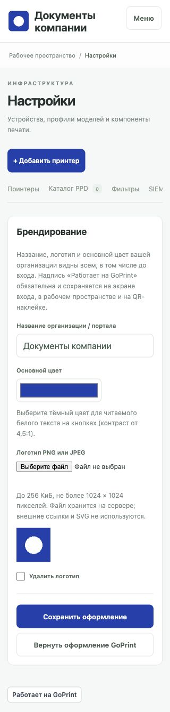

# Брендирование GoPrint

Администратор может оформить портал под свою организацию. Обязательная видимая подпись: **«Работает на GoPrint»**. Она сохраняется на экране входа, в рабочем пространстве пользователей и администраторов, а также на печатной QR-наклейке. Подпись видна и на мобильных устройствах. Настройки и API не позволяют отключить, заменить или скрыть её. Цвет подписи независим от выбранной фирменной палитры.

## Настройка

Откройте **Настройки → Брендирование** под учётной записью администратора:

- Название организации или портала: 1–80 символов.
- Основной цвет: формат #RRGGBB; контраст с белым текстом от 4,5:1. Слишком светлый цвет отклоняется с понятным объяснением.
- Логотип: PNG или JPEG до 256 КиБ, ширина и высота до 1024 пикселей. Сервер проверяет изображение и пересохраняет его в PNG без исходных метаданных. Если результат слишком велик, уменьшите разрешение.

Нажмите «Сохранить оформление». Страница обновится с новым оформлением. Чтобы заменить только название или цвет, оставьте поле загрузки пустым: сохранённый логотип останется. Флажок «Удалить логотип» удаляет его. Кнопка «Вернуть оформление GoPrint» возвращает название GoPrint, зелёную палитру и стандартный знак G.

Название и логотип публичны: они видны до авторизации. Внешние URL логотипов, SVG, произвольные HTML и CSS не поддерживаются. Оформление не меняет права пользователей, настройки печати или подключения к домену.

Демонстрационные название и логотип; подпись GoPrint остаётся видимой.

## Хранение и API

Оформление хранится в настройке branding основной базы SQLite или PostgreSQL, включая нормализованное изображение. Оно сохраняется после перезапуска и переносится вместе с настройками при миграции базы. Включайте основную БД в резервные копии. Отдельная SQL-миграция для включения брендирования не нужна.

GET /api/branding публично возвращает name, color, logo_url и обязательное attribution. Изображение доступно по /assets/brand-logo, палитра по /assets/branding.css. PUT /api/branding доступен только администратору и принимает name, color, необязательный logo_base64 (только содержимое base64 без data: префикса) и remove_logo. Пустой logo_base64 сохраняет существующее изображение. Неизвестные поля, в том числе попытки отключить подпись, отклоняются. Защита Origin/CSRF и Content Security Policy сохраняется.

Брендирование является возможностью интерфейса. Лицензия исходного кода остаётся Apache-2.0, авторские уведомления и лицензии сторонних компонентов сохраняются.
