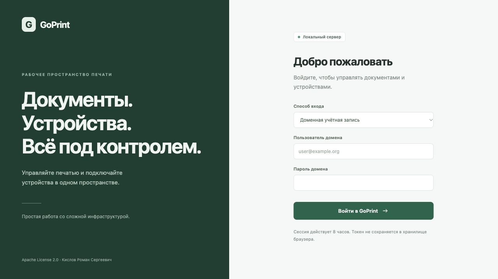
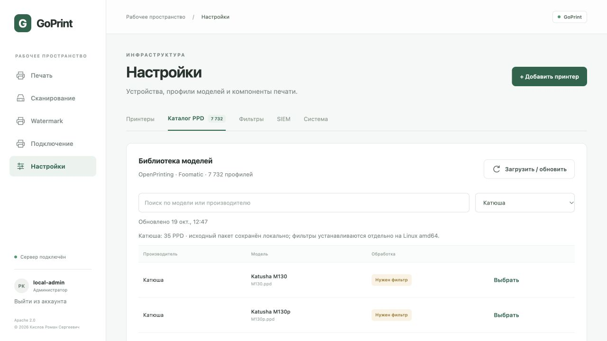
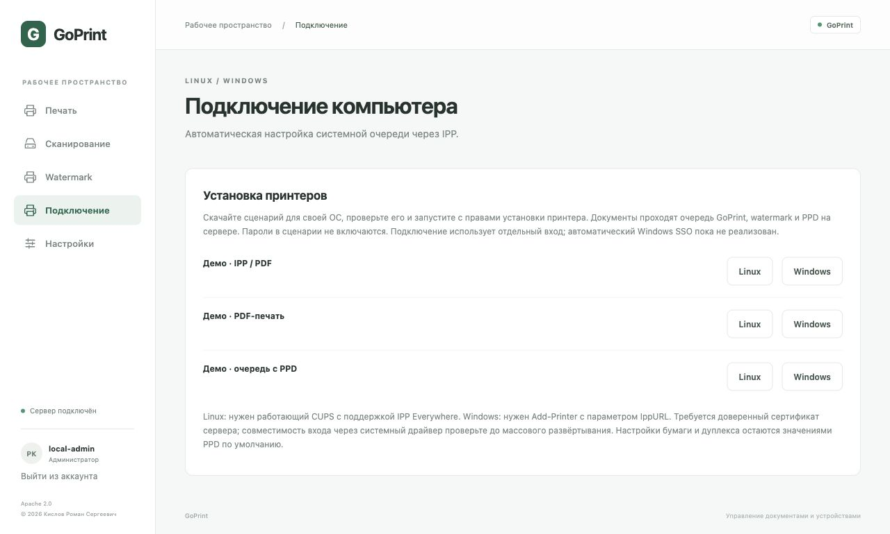

# Домен, Катюша и подключение Linux/Windows

Эти функции добавлены после v0.1.0-alpha.1. PDF первого выпуска описывают прежнюю версию; для новых функций используйте это дополнение и текущий исходный код.

## Active Directory / Samba AD

GoPrint проверяет имя и пароль через LDAP bind. Поддерживаются LDAPS и LDAP с обязательным StartTLS, TLS не ниже 1.2, проверка сертификата и DNS-имени контроллера. Незашифрованный bind запрещён. Kerberos/NTLM SSO, автоматический вход через Windows-сессию и присоединение самого сервера к домену не реализованы.

Настройка не требует служебного пароля: после bind пользователь сам читает свою запись и членство в группах. У доменного пользователя должно быть право читать эти атрибуты. Проверяется вложенное членство через LDAP_MATCHING_RULE_IN_CHAIN, OID 1.2.840.113556.1.4.1941. Поддержку этого правила и чтения атрибутов нужно проверить на конкретном AD/Samba AD.

1. Создайте группу разрешённых пользователей GoPrint и отдельную группу администраторов. Администратор должен входить и в разрешённую группу.
2. Скопируйте `packaging/domain.example.json` в `/etc/goprint/domain.json`. Укажите URL контроллера, DNS-домен, NetBIOS-имя, Base DN и **полные DN** групп.
3. Сохраните корневой/промежуточный CA в PEM-файл и укажите ca_file. Если сертификат уже доверен системным хранилищем, поле ca_file можно удалить.
4. Обеспечьте пользователю службы чтение конфигурации и CA. Не добавляйте пароль в JSON — в схеме такого поля нет.
5. В override systemd добавьте к существующему ExecStart `-domain-config /etc/goprint/domain.json`. Для сетевых клиентов также нужны TLS-параметры и `-public-url https://print.example.org:8631`. В override сначала сбросьте ExecStart пустой строкой, затем задайте полный новый ExecStart.
6. Выполните `systemctl daemon-reload` и `systemctl restart goprint`.

Пример полного сетевого ExecStart:

```ini
[Service]
ExecStart=
ExecStart=/usr/local/bin/goprintd -data /var/lib/goprint -listen 0.0.0.0:8631 -tls-cert /etc/goprint/server.crt -tls-key /etc/goprint/server.key -domain-config /etc/goprint/domain.json -public-url https://print.example.org:8631
```



На экране входа появится выбор способа входа. Принимаются user, user@example.org и EXAMPLE\user (NetBIOS-префикс — из конфигурации). Имена аккаунтов в этой версии ограничены латиницей, цифрами, точкой, дефисом и подчёркиванием. Пароль не сохраняется и не попадает в журнал. При недоступности домена вход закрывается; автоматического перехода к локальному доступу нет. Локальный токен остаётся отдельным способом аварийного входа администратора.

Сессии подписаны и действуют 8 часов; имя и права из запроса не считаются подтверждением личности. Изменение членства в группах учитывается при новом входе. Для IPP успешная проверка учётных данных кешируется до 30 секунд без хранения открытого пароля. Смена GOPRINT_TOKEN сбрасывает действительность всех браузерных сессий после перезапуска. Старые браузерные cookie alpha.1 нужно заменить повторным входом.

Права пользователя: просмотр принтеров, печать, просмотр/отмена собственных заданий, запуск сканирования, скачивание собственных сканов, получение сценариев подключения. Права администратора: настройки устройств, PPD, фильтры, SIEM, watermark, все задания и сканы. Входящие файлы WebDAV МФУ доступны только администраторам, поскольку личный получатель на МФУ пока не задаётся. Старые задания и сканы остаются у local-admin.

Проверено на тестовом LDAPS-сервере: bind, отказ при неверном пароле и недоверенном сертификате. Реальный домен по запросу пользователя не подключался. Перед внедрением проверьте разрешённую/запрещённую группу, вложенные группы, администратора и обычного пользователя.

## PPD и фильтры Катюша

При включённой предзагрузке GoPrint загружает официальный универсальный пакет 2.1-1 с сайта производителя. «Загрузить / обновить» в каталоге обновляет OpenPrinting и набор Катюша. При временном отсутствии сайта прежние профили остаются доступны. PPD Катюша сохраняются между обновлениями OpenPrinting.



Из проверенного пакета импортируются 35 PPD: M130/P130, M247, M348, M133/P133, M140/P140, M240, M325, M350, M450, P247 и варианты профилей. Одинаковое отображаемое имя может соответствовать разным PPD; сравнивайте имя файла. Набор может не охватывать последние модели производителя.

Исходный ZIP сохраняется в ppds; проверяется SHA-256:

```text
83457754520049c4c8138d493013e0d21068e4a9d2b5259977688fa1eecc514c
```

Если производитель заменит архив, несовпадение суммы остановит импорт до проверки новой версии. Установщики, пакетные хуки и исполняемые файлы при импорте **не запускаются**. Пакеты и PPD не публикуются в репозитории GoPrint и не перелицензируются под Apache 2.0. Применяются условия производителя; сохранён исходный архив с сопроводительными материалами.

Офлайн-импорт официального ZIP при остановленной службе:

```sh
sudo systemctl stop goprint
sudo -u goprint goprint-ppds -katusha \
  -dir /var/lib/goprint/ppds -archive /path/readable-by-goprint/universal.zip
sudo systemctl start goprint
```

В «Настройки → Фильтры» доступны загруженные официальные DEB для универсального набора, M130/P130, M247 и M348. Фильтры в этом архиве предназначены для Linux amd64, не ARM64. Установку подходящего пакета выполняет администратор пакетным менеджером своей ОС с проверкой зависимостей; GoPrint не запускает sudo. Для RPM-дистрибутивов используйте RPM из исходного официального архива. Windows-клиентам эти Linux-пакеты не нужны: преобразование выполняется на сервере.

PPD сам по себе недостаточен: например, M140 требует установленный cups-фильтр Katusha/Katusha_M140. Если фильтр не установлен или не исполняется, задание блокируется до передачи устройству. Сервер должен работать от непривилегированного пользователя. Совместимость физического устройства ещё требует проверки.

Официальный источник: https://www.katusha-it.ru/downloads

## Автоматическая настройка Linux и Windows

В веб-консоли откройте «Подключение», выберите принтер и скачайте Linux- или Windows-сценарий. Он содержит имя локальной очереди и адрес **очереди GoPrint**, не прямой адрес устройства. Пароли и токены в сценарий не включаются. Сценарии можно использовать как основу для управляемого развёртывания, предварительно проверив вход на тестовом компьютере.



Для сетевой установки задайте -public-url с доступным компьютерам DNS-именем и доверенным сертификатом. Адрес 127.0.0.1 пригоден только на том же компьютере, где работает сервер. На клиентах должны быть доверены сертификат сервера и его цепочка.

Linux: нужен работающий CUPS и lpadmin с поддержкой `-m everywhere`. Запустите `sudo bash goprint-linux.sh`: сценарий создаёт очередь и включает запрос учётных данных username/password при печати. Используется driverless-профиль, полученный через IPP. При отправке документа CUPS может запросить доменные данные или local-admin/локальный токен. Не вставляйте пароль в URI или текст сценария.

Windows: нужен Windows с Add-Printer и параметром IppURL. Запустите PowerShell-сценарий с правами добавления принтера. Он использует штатный Microsoft IPP Class Driver и не отключает проверку TLS или политики безопасности драйверов. Если команда недоступна, сценарий завершится с пояснением. Политика запуска PowerShell должна разрешать проверенный сценарий обычным принятым в организации способом; глобальное отключение Execution Policy не требуется.

Авторизация IPP использует HTTP Basic поверх TLS: имя домена/пароль либо local-admin/локальный токен. Чтение описания одного известного принтера через Get-Printer-Attributes доступно без входа для установки драйвера; названия принтера и поддерживаемые входные форматы при этом видны. Печать, список/просмотр/отмена заданий требуют входа. Ввод requesting-user-name не позволяет подменить владельца. Пароль браузерной сессии системному драйверу не передаётся.

**Проверка Windows обязательна перед GPO:** поддержка запроса HTTP Basic зависит от версии Windows, IPP-клиента и корпоративной политики. Автоматический Kerberos/NTLM SSO не реализован; если штатный клиент не предлагает авторизацию, установка очереди сама по себе ещё не означает работающую печать. Используйте браузерную печать GoPrint до проверки поддерживаемого клиентского способа входа. Прямой обход GoPrint сценарии не создают.

Задания идут по цепочке: клиентская очередь → входящий IPP GoPrint → постоянная очередь → watermark → PPD/фильтры → устройство → события SIEM. Максимум один документ на задание. Поддерживаются Print-Job, Create-Job/Send-Document, Validate-Job, Get-Printer-Attributes, Get-Jobs, Get-Job-Attributes и Cancel-Job. Create-Job без документа остаётся в состоянии «Ожидает документ» и не отправляется устройству. Повторный Send-Document не заменяет уже принятый файл.

Автонастройка доступна для очередей с PPD или входным PDF. Описываются параметры виртуальной очереди: для PPD — бумага/дуплекс/цвет по умолчанию, для прямого PDF — входной A4 в цвете. Другие параметры задания не меняют PPD: неподдерживаемые значения отклоняются, а не молча игнорируются. Это минимальная совместимость с IPP, не сертификация IPP Everywhere/Mopria. Windows и физические Linux-клиенты ещё не проверялись; системный ipptool CUPS и генерация клиентского PPD утилитой driverless проверены автоматическими тестами (в том числе на Linux CI).

Документация команд ОС:
- https://openprinting.github.io/cups/doc/man-lpadmin.html
- https://learn.microsoft.com/en-us/powershell/module/printmanagement/add-printer
