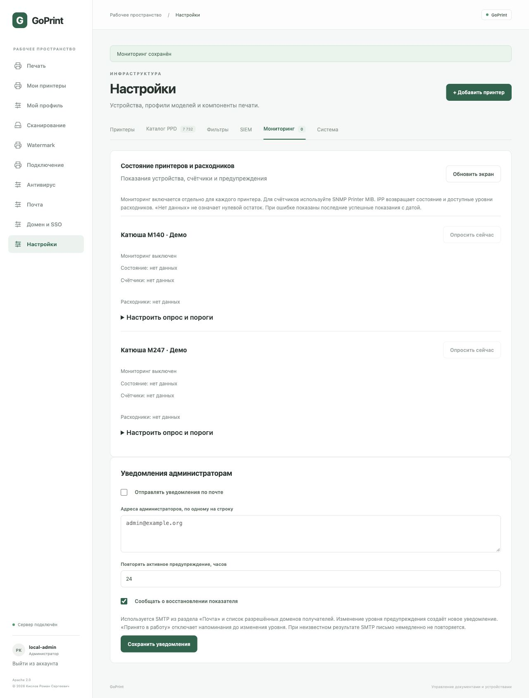

# Мониторинг принтеров и уведомления

Доступен только администраторам: **Настройки → Мониторинг**. Для каждого принтера отдельно включите опрос. По умолчанию он выключен; автоматического подбора community и паролей нет. Мониторинг не изменяет настройки принтера и не отправляет SNMP SET.

## Что показывает сервер

- Уровни тонера, чернил, барабанов и других расходников, которые публикует устройство.
- Заполнение контейнера отработки, если устройство указывает соответствующий класс расходника.
- Счётчики печатающих механизмов SNMP Printer MIB с их исходными единицами. `impressions` — отпечатанные стороны, `sheets` — листы. Разные механизмы не суммируются: это могло бы удвоить счётчик.
- Состояние и сообщения IPP; серийный номер через стандартный SNMP Printer MIB, если он доступен.
- Последнее успешное получение данных, ошибки опроса и активные предупреждения.

Это показания устройства, а не количество заданий GoPrint. Счётчик устройства может включать копирование и печать из других источников, обнуляться или переполняться согласно его реализации. Уровни расходников могут быть приблизительными. Отрицательные специальные значения, отсутствие атрибута и непригодная ёмкость обозначаются «Нет данных», а не 0%. Фирменные счётчики цветной/монохромной печати и нестандартные OID пока не подключены.

## Настройка SNMP

Используйте SNMP для принтера с адресом `socket://device:9100`, а также когда нужен аппаратный счётчик. Имя узла берётся из адреса принтера; порт задаётся отдельно, обычно UDP 161. Разрешите трафик от GoPrint к устройству и обратные ответы.

Предпочтительная настройка — **SNMPv3 authPriv, SHA-256, AES-128**. Создайте на устройстве отдельного пользователя с доступом только для чтения и укажите его имя, пароль аутентификации и пароль шифрования. Не все старые модели поддерживают это сочетание; проверьте документацию и прошивку МФУ.

Для старых устройств предусмотрен **SNMPv2c** с явно заданной read-only community. Этот протокол не шифрует данные и community; используйте его только в изолированной доверенной сети. Автоматического отката с v3 на v2c нет.

Пароли и community не возвращаются API и сохраняются в БД зашифрованными. Ключ `monitoring.key` в каталоге данных имеет права 0600; включайте его в защищённую резервную копию всей установки. Пустое поле при сохранении оставляет прежний секрет. Для смены введите новое значение.

## Настройка IPP/IPPS

Выберите IPP. Для очереди `ipp://` или `ipps://` можно оставить URL мониторинга пустым. Если печать идёт через JetDirect, укажите отдельный реальный IPP endpoint устройства, например `ipps://printer.example.org/ipp/print`: путь должен соответствовать документации модели.

GoPrint делает только Get-Printer-Attributes. Поддерживаются уровни `marker-*` и стандартные `printer-supply`. IPPS проверяет сертификат и имя через системное хранилище доверия; отключения проверки нет. IPP-аутентификация для отдельного защищённого endpoint мониторинга пока не реализована. По IPP аппаратный суммарный счётчик не выдумывается: если нужен стандартный lifetime counter, используйте SNMP.

## Опрос и предупреждения

Интервал — от 60 до 3600 секунд, по умолчанию 300. Одновременно опрашиваются не более четырёх устройств; при большом парке полный цикл может занять больше времени. Сетевой опрос ограничен временем и объёмом ответа. «Опросить сейчас» не выполняет повторный сетевой запрос чаще раза в 15 секунд; «Обновить экран» читает сохранённые данные. Открытая вкладка обновляет экран раз в минуту.

Пороги по умолчанию: предупреждение при остатке **20%**, критический уровень при **5%**. Порог включается при равенстве. Для контейнера отработки сравнивается свободная ёмкость: это соответствует заполнению 80% и 95%. После восстановления выше порога предупреждения более чем на 3 процентных пункта событие закрывается — это уменьшает дребезг около порога.

Отсутствие связи после трёх последовательных неудачных опросов создаёт отдельное предупреждение. Последние показания сохраняются с прежним временем; это не свежие данные. Исчезнувший расходник или неизвестный уровень не закрывает старое предупреждение: сервер не может считать это доказательством замены. Сам факт замены не определяется — уведомление о восстановлении означает восстановление показателя.

## Уведомления по email

1. Настройте SMTP в разделе **Почта**, включите TLS/STARTTLS и добавьте домены адресатов в разрешённый список.
2. В **Настройки → Мониторинг** укажите адреса администраторов, включите email и выберите период напоминаний (1–720 часов, по умолчанию 24).
3. При необходимости включите сообщение о восстановлении.
4. Проверьте контролируемое тестовое предупреждение на стенде, получателя и журнал результата в карточке. Не создавайте предупреждение физическим повреждением или расходованием устройства.

Письмо содержит принтер, показатель, уровень и время; документы не прикладываются. Каждому адресу письмо отправляется отдельно. Первое предупреждение, изменение степени и восстановление являются отдельными событиями. Одинаковые письма не отправляются при каждом опросе; повтор активного события разрешён только через интервал напоминания. «Принято в работу» отключает напоминания до изменения степени или нового события. Состояние сохраняется в SQLite/PostgreSQL и переживает перезапуск.

Результаты почты: **отправлено**, **ошибка отправки**, **результат неизвестен**. Успех SMTP означает принятие почтовым сервером, а не прочтение или доставку в почтовый ящик. При потере подтверждения DATA немедленного повтора нет: это предотвращает дубли. После перезапуска незавершённая отправка также считается неопределённой; следующее плановое напоминание может быть отправлено после настроенного интервала. Ошибка SMTP не скрывает предупреждение в интерфейсе. Если SMTP выключен или домен запрещён, сначала исправьте настройки.

## Проверка совместимости

Выполнены тесты обмена IPP, SNMPv2c по UDP, TLS SMTP с потерянным подтверждением, специальных неизвестных значений, нестандартных индексов Printer MIB, прав администратора и устойчивости предупреждений при перезапуске. Работа с конкретной моделью и SNMPv3 на физическом устройстве требует пилота.

Справочники: [Printer MIB v2, RFC 3805](https://www.rfc-editor.org/rfc/rfc3805), [CUPS IPP supply attributes](https://openprinting.github.io/cups/libcups/spec-ipp.html), [GoSNMP](https://github.com/gosnmp/gosnmp).
