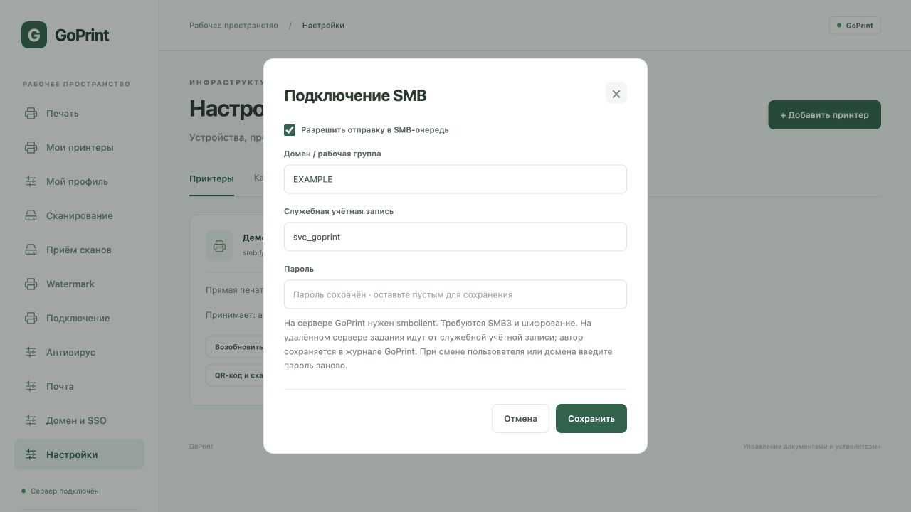

# Печать Samba ↔ GoPrint

## Входящий мост Samba → GoPrint

Добавлены `goprint-samba-submit` и дополнительный Unix-сокет `goprintd -samba-config /etc/goprint/samba.json`. Через обычный TCP/HTTP API этот мост недоступен. Утилита запускается Samba от Unix-пользователя печати и не использует административный токен.

GoPrint получает UID соединения от ядра (SO_PEERCRED на Linux), сопоставляет UID с UPN из конфигурации администратора и заново разрешает пользователя и группы через служебный LDAP bind. Чужой UPN, токен или имя из HTTP-заголовка не заменяют эти данные. Права администратора домена не предоставляют обход ACL через мост: печать проверяется как пользовательская. Без сопоставления, работающего каталога или права на принтер документ не принимается.

Принятые задания сохраняют UPN владельца, его параметры бумаги/цвета/дуплекса и Follow Me. Используется та же постоянная очередь и рабочая цепочка антивирус → watermark → PPD → устройство, что у веб-печати. ID принятого задания и состояние результата сохраняются в settings основной БД. Для одинакового spool ID повтор возвращает прежний ID без нового задания; после неопределённого результата нужен осмотр очереди. Область повторов включает UID, UPN и принтер. Это не защита от повторного создания нового файла задания клиентом Windows.

### Проверка нового моста

В изолированном контейнере Linux arm64 с Samba 4.20.6 настоящие SMB3-задания от Unix-пользователей alice/bob прошли через новый helper и Unix-сокет без токена GoPrint в Samba. В очереди сохранены разные владельцы alice@example.org и bob@example.org. Alice получила held-release, дуплекс и monochrome; Bob — queued, one-sided и color. Для протокольного стенда LDAP-каталог заменён контролируемым тестовым resolver; реальный AD/Samba AD и Windows-драйвер в этом испытании не использовались.

Отдельно тем же helper проверены запреты для UID без сопоставления, закрытого принтера и отозванной записи каталога: нового задания нет, исходный spool остаётся. После успешного приёма искусственно запрещено удаление файла: повтор после восстановления прав вернул прежнее задание, без дубликата. Неизвестный EMF отклонён до передачи. Автоматические тесты проверяют подмену владельца заголовком, отсутствие доступа по TCP/токену, групповые ACL, смену сопоставленного UPN, повтор accepted и неопределённую квитанцию, а также ограничения конфигурации и сокета. Для реального внедрения всё ещё нужен пилот с LDAP, NSS/Winbind, клиентскими драйверами и физическим устройством.

### Подготовка Linux/Samba

1. Установите собранные `goprintd` и `goprint-samba-submit` в `/usr/local/bin`. Никаких setuid, sudo и токенов в print command не требуется.
2. Настройте AD/Samba AD в `domain.json`: разрешённую группу и служебное LDAP-чтение (`directory_bind_dn`, `directory_password_file`). Сервер не запускает мост без этих параметров. Пароли пользователей мосту не передаются.
3. Создайте отдельную группу `goprint-submit`. Добавьте в неё только разрешённых Unix-пользователей Samba (либо настройте соответствующее NSS/Winbind-членство). Не добавляйте их в служебную группу `goprint`, которая может иметь доступ к конфигурации и секретам.
4. По `getent passwd` / `id -u 'DOMAIN\user'` определите реальные стабильные UID. По `getent group goprint-submit` определите GID. Замените демонстрационные числа в [samba.example.json](../packaging/samba.example.json). Ключи users — UID, значения — доменные UPN. UID 0 и неоднозначные числа отвергаются. Никогда не сопоставляйте общий служебный UID одному человеку: Samba должна сохранять уникальные UID аутентифицированных пользователей. При изменении NSS/idmap или повторном использовании UID обновите сопоставления и перезапустите GoPrint.
5. Сохраните конфигурацию в `/etc/goprint/samba.json`, владельцем назначьте администратора, запретите запись группе и остальным (например, root:goprint, 0640). Настройки читаются при запуске, горячей замены нет.
6. Настройте каталог сокета: владелец goprint, группа goprint-submit, режим 0750. Сокет создаётся с режимом 0660 и заданным GID. Пример systemd drop-in — [samba-systemd.example.conf](../packaging/samba-systemd.example.conf): он создаёт RuntimeDirectory и меняет группу каталога от имени владельца. Сохраните свои параметры HTTPS, public-url, БД и прочие ExecStart-флаги. Каталог с записью для группы/остальных отвергается. Оставшийся после аварии сокет удаляйте вручную только после проверки отсутствия работающего процесса; активный сокет не заменяется.
7. Включите печатную шару из [samba-share.example.conf](../packaging/samba-share.example.conf), замените PRINTER_ID. Сохраните доменные настройки действующего smb.conf. Не используйте `printing=cups` для этой шары: он обходит произвольный print command. Не задавайте force user / admin users и другие параметры, превращающие разные учётные записи в один UID. Проверьте итоговый конфиг `testparm -s`, перезапустите службы и проверьте права каталога и сокета от каждого разрешённого пользователя. При AppArmor/SELinux настройте точечный доступ к сокету и утилите по журналу отказов; отключение защиты не требуется.

### Документы, повторы и ограничения

По умолчанию утилита распознаёт PDF, PostScript, JPEG, PNG и PWG Raster по сигнатуре. EMF/XPS и неизвестные данные отклоняются. Для заранее подготовленного RAW нужна явно настроенная очередь и `-format application/octet-stream`; при обязательном watermark допустим только PDF. Поддержка Windows Point and Print и клиентских драйверов не добавлена этим мостом.

Файл должен быть обычным, без символьной ссылки, лежать непосредственно в spool-dir (по умолчанию /var/spool/samba) и быть непустым, размером не более 100 МиБ. Утилита вычисляет стабильный ID по имени, размеру, времени изменения и содержимому; после подтверждённого принятия удаляет тот же неизменённый файл. При отказе, тайм-ауте, некорректном ответе или неопределённом результате файл сохраняется. Повтор того же файла безопасен только с прежним ID: не переименовывайте и не меняйте его до проверки результата. При 409 администратор проверяет очередь и журнал; автоматического повторного создания задания нет.

Просмотр/отмена заданий выполняются в GoPrint. Синхронизация lpq/lprm Samba и SMB/Kerberos-делегирование пока отсутствуют. Уже принятые задания не отменяются при последующем отзыве доступа; новые запросы и повторы заново проверяют каталог и ACL. Процесс GoPrint — один на каталог данных. Копируйте при резервировании и миграции настройки/UID-карту и основную БД с квитанциями.

## Исходящая печать GoPrint → Samba / SMB

В v0.2.0-beta.3 можно добавить `smb://print.example.org/accounting`. Только имя сервера и одна очередь: без пароля, порта, вложенного пути и URL-экранирования. Допустимы буквы ASCII, цифры, точка, дефис, подчёркивание; в имени очереди также `$`. Используется TCP 445. IPv6-адреса и имена шар с пробелами пока не поддерживаются.

1. На Linux-сервере GoPrint установите **smbclient** (Debian/Ubuntu: `sudo apt install smbclient`, RHEL-подобные: `sudo dnf install samba-client`). Нужна версия с параметрами `--use-kerberos` и `--client-protection`. Протокольная проверка выполнена с Samba 4.20.6. Сборки GoPrint не включают Samba.
2. На принимающем сервере создайте печатную очередь и служебную учётную запись с правом печати только в нужные очереди. Включите SMB3 и шифрование. SMB1/SMB2 и незашифрованная передача не используются. Это парольная аутентификация служебной записи через NTLMv2 в шифрованном SMB3-сеансе; делегирования Kerberos пользователя нет. Это не включает NTLM-вход в веб-интерфейс GoPrint.
3. Добавьте принтер в «Настройки», укажите SMB URI и формат, который принимает удалённая очередь. При необходимости выберите PPD: сервер передаёт уже подготовленный результат фильтрации. Не применяйте второй драйвер на удалённом сервере к уже подготовленному RAW/PCL/PostScript. Сначала оставьте очередь на паузе.
4. Нажмите **«Подключение SMB»** в карточке. Включите отправку, введите домен/рабочую группу, имя служебной записи и пароль. Сохраните. Пустой пароль сохраняет прежний только для того же имени и домена; при смене имени/домена нужен новый пароль. Снятие флажка блокирует последующие отправки, сохранённый пароль остаётся для повторного включения.
5. Возобновите очередь и отправьте одну тестовую страницу. Проверьте журнал GoPrint, удалённую очередь и бумажный результат. Параметры SMB доступны только администраторам; пользователю достаточно выбрать доступный принтер обычным способом.

Пароль хранится в БД с AES-GCM, привязан к ID принтера; ключ `smb.key` находится в каталоге данных с режимом 0600. Резервируйте БД и ключ вместе с остальными данными. Не копируйте ключ в публичный репозиторий. В API пароль не возвращается; передача в smbclient идёт через временный файл 0600 в каталоге 0700, удаляемом после отправки. Пароля нет в URI, аргументах процесса или журнале. После аварийного завершения ОС может оставить временный каталог: администратор удаляет его только после проверки отсутствия выполняющейся отправки. Исходящий процесс не получает токены и переменные окружения GoPrint. Нужен доступ службы к smbclient, системным библиотекам и временным файлам; стандартный unit с PrivateTmp подходит.

Каждое задание сначала проходит проверку соединения без печати. Ошибка до отправки получает `failed`. После начала команды печати ошибка/тайм-аут получает `unknown`; автоматического повтора нет. Проверьте удалённую очередь перед повторным созданием задания. `submitted` означает подтверждение передачи сервером SMB, но не успешную обработку его print command и не выход бумаги. Удалённый ID задания не возвращается. Автор в GoPrint сохраняется; удалённый сервер видит служебную запись. Не настраивайте взаимную пересылку одной очереди Samba → GoPrint → та же Samba: это создаёт цикл.

Проверено 23.10.2026: настоящий сервер Samba 4.20.6 в изолированном Linux arm64-контейнере, обязательные SMB3 и шифрование, совпадение SHA-256 отправленного и принятого файла; неверный пароль заблокирован до печати. Автотесты проверяют шифрование хранения, привязку секрета к принтеру, защиту от внедрения команд/строк конфигурации, очистку окружения, неопределённый результат и отсутствие повторов. Реальный Windows Print Server, домен и физический принтер требуют пилота.

## Историческая проверка до добавления моста

Проверено 20.10.2026 для кода `d3b8412`. Доменный вход Samba AD через LDAP — отдельная возможность; он не означает поддержку печати через SMB.

## Стенд и границы проверки

Изолированный Linux arm64-контейнер: Alpine 3.21, Samba/smbclient/smbspool 4.20.6, libcups 2.4.18, GoPrint. Контейнер без внешней сети и опубликованных портов. Два синтетических пользователя `alice` и `bob`, тестовый PDF 53 байта; очередь GoPrint приостановлена. SMB1 не использовался; smbclient запускался с обязательным шифрованием. Пароли и токен созданы только внутри стенда. Физического принтера, Windows-клиента и реального AD в этом испытании не было.

## GoPrint → SMB-принтер / очередь Samba

- Добавление `smb://server/share` через API GoPrint отклоняется: HTTP 400, `supported URI schemes: socket, ipp, ipps`.
- URI с именем и паролем также отклоняется. Учётные данные в URI не поддерживаются текущим API.
- Отдельный штатный `smbspool` успешно отправил тот же PDF в тестовую Samba-очередь: код завершения 0 и один принятый файл. Этот запуск сделан вручную в стенде, не из обработчика GoPrint.

Итог: транспорт Samba доступен как внешняя утилита, но GoPrint пока не имеет исходящего SMB-бэкенда. Успех отдельного smbspool не означает поддержку smb:// в GoPrint.

## SMB-клиент → Samba → GoPrint

### Тестовый обработчик print command

Samba с `printing=bsd` и лабораторным обработчиком `print command` передала PDF в HTTP API GoPrint. Задания от двух SMB-пользователей приняты. Но при отправке с административным Bearer-токеном оба получили владельца `local-admin`, хотя Unix-пользователь обработчика и владелец исходного spool-файла различались (`alice` / `bob`). Анонимный вход отклонён.

Это не готовая пользовательская интеграция. Такой обработчик действует с полномочиями администратора: не сохраняет доменного владельца и не обеспечивает персональные ACL, Follow Me, пользовательскую маркировку и аудит от имени исходного SMB-пользователя. Он не включён в поставку и не приводится как инструкция установки. Утверждать владельца через произвольное поле HTTP-запроса также нельзя: владелец должен определяться доверенной аутентификацией.

### Штатный режим printing=cups напрямую на GoPrint

Samba, собранная с libcups, была направлена на HTTP-адрес GoPrint через `cups server`, с отдельной печатной шарой и именем существующего принтера GoPrint.

Первый клиентский запрос завершился тайм-аутом; повторный smbclient завершился с кодом 0, однако журнал Samba зафиксировал `cups_job_submit: client-error-not-found`. Число заданий в GoPrint не увеличилось. Дополнительный `lpstat -h <GoPrint> -p` завершился кодом 1: `Scheduler is not running`.

GoPrint реализует входящие операции IPP по `/ipp/printers/<id>`, но не интерфейс планировщика CUPS и его пути `/printers/<name>` / операции перечисления. Поэтому настройка `printing=cups` не делает GoPrint непосредственной заменой CUPS для Samba. Успешное завершение SMB-клиента само по себе не подтверждает постановку задания в GoPrint.

## Эксплуатационный статус

На момент этой исторической проверки оба направления требовали отдельной интеграции. Входящий Unix-мост описан выше; исходящий SMB-бэкенд пока не добавлен. В текущей поставке используйте документированные IPP/IPPS или JetDirect и входящий IPP GoPrint. Проверка выше подтверждает ограничения текущей версии; она не подтверждает Windows Point and Print, Kerberos SMB, передачу клиентских билетов, EMF/XPS или физическую печать. Повтор после неоднозначной доставки требует проверки очередей, чтобы избежать дубликатов.

Документация Samba: [smb.conf — printing и print command](https://www.samba.org/samba/docs/current/man-html/smb.conf.5), [smbspool](https://www.samba.org/samba/samba/docs/current/man-html/smbspool.8.html). В частности, при `printing=cups` и сборке с libcups произвольный `print command` игнорируется; аргумент user утилиты smbspool не является подтверждением исходной личности, за исключением его специального использования для Kerberos cache.
