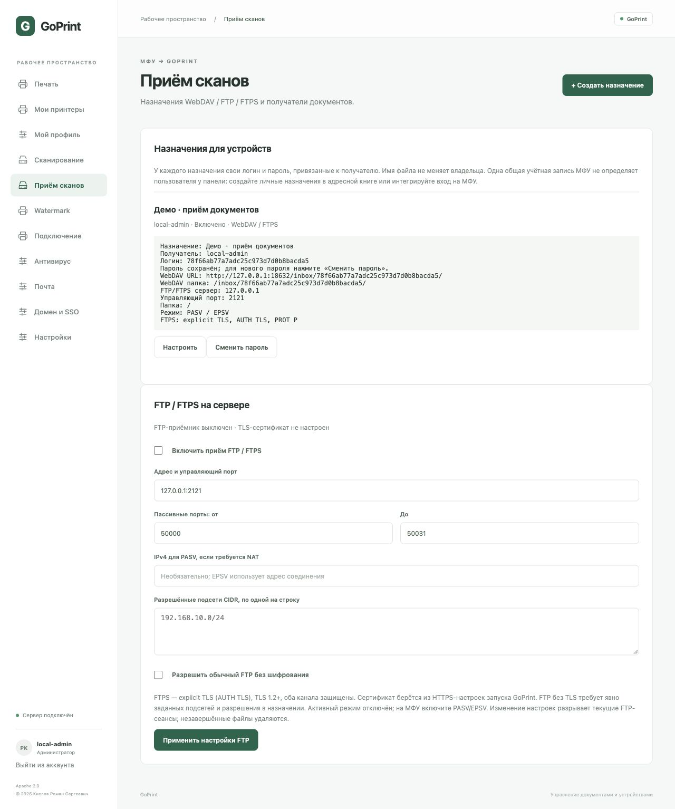

# Приём сканов с МФУ: WebDAV, FTP и FTPS

GoPrint принимает файлы непосредственно от МФУ и сохраняет их в документы закреплённого пользователя. Настройка доступна только администратору в разделе **Приём сканов**. Сервер FTP по умолчанию выключен.

## Назначение и получатель

1. Нажмите **Создать назначение**, задайте понятное название и выберите существующий сканер либо **Новое устройство только для приёма**. Для FTP/WebDAV не требуется наличие eSCL у МФУ.
2. Введите UPN пользователя, например `ivanov@example.org`, либо `local-admin`. Это имя входа в домен, оно может отличаться от почтового адреса.
3. Выберите разрешённые протоколы и максимальный размер файла (1–100 МиБ, по умолчанию 20).
4. Сохраните назначение и перенесите показанные логин/пароль в адресную книгу МФУ. Пароль показывается один раз. Хранится только SHA-256 от случайного 256-битного пароля; доменный пароль на МФУ вводить не требуется.

Получатель определяется сервером по назначению, а не по имени файла, подпапке, заголовку или данным, переданным МФУ. Доступ пользователя к домену проверяется через защищённый LDAP при загрузке и повторно перед публикацией. Настройте служебную учётную запись чтения каталога в доменной конфигурации. Если домен ещё не подключён, можно подготовить назначения с UPN, но загрузки для них будут отклонены; `local-admin` работает без домена.

Для совместно используемого МФУ создавайте отдельные назначения в адресной книге, закреплённые за пользователями, или интегрируйте аутентификацию на панели. Статическая общая учётная запись устройства не сообщает серверу, кто положил документ в автоподатчик. Любой пользователь панели с доступом к чужому назначению потенциально может отправить файл этому получателю: права адресной книги ограничиваются средствами МФУ.

После успешного приёма документ виден владельцу и администраторам. Личное правило доставки сканов по SMTP применяется автоматически, если пользователь заранее включил его, формат/размер подходят и SMTP разрешает адрес получателя. Администраторская почтовая доставка использует профиль `local-admin`.

**Смена получателя автоматически меняет пароль.** Старый пароль перестаёт работать, в том числе для загрузки через ранее открытый FTP-сеанс. Отдельная кнопка **Сменить пароль** также отзывает прежний ключ. Выключение назначения блокирует новые загрузки и публикацию уже загружающегося документа. Старые документы сохраняют прежнего владельца.

## WebDAV на МФУ

В адресной книге создайте назначение WebDAV:

- Сервер: DNS-имя GoPrint, например `print.example.org`.
- HTTPS/SSL: включено; МФУ должно доверять сертификату и имени сервера.
- Порт: порт HTTPS GoPrint, например `8631`.
- Папка: `/inbox/<ID назначения>/`.
- Имя пользователя: ID назначения.
- Пароль: отдельный пароль назначения.
- Формат: PDF, JPEG или PNG.

Некоторые модели используют единое поле полного URL — скопируйте его из карточки назначения. Полный адрес формируется по `-public-url`, если он задан; иначе по адресу текущего интерфейса. `127.0.0.1`, `localhost` и `0.0.0.0` не являются сетевым адресом сервера для МФУ. Настройте реальное DNS-имя, HTTPS и сетевой адрес прослушивания согласно основной инструкции.

Поддерживаются OPTIONS, PROPFIND Depth 0/1, HEAD корня, MKCOL и прямой PUT файла. Входящая папка не предназначена для скачивания или просмотра сохранённых документов. МФУ должно отправлять итоговый файл прямым PUT; схемы WebDAV с MOVE, LOCK/UNLOCK или временным PUT + MOVE пока не поддержаны. Проверьте модель и прошивку до массового развёртывания.

## FTPS — рекомендуемый FTP-вариант

В нижней части раздела **Приём сканов**:

1. Укажите адрес сервера, например `0.0.0.0:2121`, и пассивный диапазон, например `50000–50031`.
2. Укажите разрешённые CIDR-подсети устройств. Пустой список при FTPS допускает подключения из любых сетей, доступных серверу, но вход всегда требует пароль назначения.
3. Включите приём и примените настройки. Изменение настроек завершает существующие FTP-сеансы и удаляет незавершённые файлы.
4. Разрешите в межсетевом экране управляющий TCP-порт и весь выбранный пассивный TCP-диапазон от подсетей МФУ. NAT при необходимости должен пробрасывать их на тот же сервер.

FTPS использует сертификат и ключ HTTPS GoPrint (`-tls-cert` и `-tls-key`). Требуется **explicit FTPS / AUTH TLS**, TLS 1.2 или новее, **PROT P** для шифрования канала данных. Не выбирайте implicit FTPS/990 или SFTP — эти варианты не реализованы. МФУ должно доверять цепочке сертификата, проверять имя и иметь правильное время.

Параметры адресной книги МФУ:

- Узел: DNS-имя GoPrint, соответствующее сертификату.
- Порт: настроенный управляющий порт, по умолчанию 2121.
- Протокол: FTP с explicit TLS.
- Пассивный режим: включён (PASV или EPSV).
- Папка: `/`.
- Логин: ID назначения; пароль: пароль назначения.
- Передача: binary; PDF, JPEG или PNG.

Каждый логин видит отдельный пустой виртуальный корень. Отправленный файл попадает в GoPrint, а не в общую папку ОС. Если используется NAT и обычный PASV, задайте **IPv4 для PASV** — адрес сервера, доступный МФУ. EPSV использует адрес управляющего соединения, поле IPv4 ему не требуется. Активный FTP (PORT/EPRT) отключён; адрес клиента управляющего и канала данных должен совпадать.

## Обычный FTP для старых устройств

Обычный FTP передаёт пароль и документ без шифрования. Он включается только явно:

1. В глобальных настройках включите **Разрешить обычный FTP без шифрования**.
2. Задайте непустой список разрешённых CIDR-подсетей, например `192.168.10.0/24`.
3. В конкретном назначении разрешите **FTP**.

Для такого МФУ выберите обычный FTP, PASV, настроенный порт, корень `/` и отдельные учётные данные назначения. Устройство не получает доменный пароль. Не публикуйте этот режим в интернет. Разрешение обычного FTP не разрешает незашифрованный канал данных в FTPS-сеансе: для FTPS всё равно обязателен PROT P.

## Завершение передачи, ограничения и антивирус

Файлы сначала записываются во временное приватное хранилище. Прямой FTP STOR публикуется только после завершения передачи и проверки; файлы `.tmp`, `.part`, `.partial` и имена с ведущей точкой ожидают RNFR/RNTO в пределах того же сеанса. Для одного сеанса допускается один незавершённый/временный файл. Каталоги и произвольные пути, скачивание, дописывание, возобновление передачи, символьные ссылки и удаление готовых документов не предоставляются. Отправляйте в `/`, не включайте на МФУ создание подпапок по дате/пользователю. Незавершённый временный файл удаляется при отключении или перезапуске.

Ограничения: 32 FTP-сеанса, 8 одновременных/ожидающих завершения загрузок, не более 20 попыток входа в минуту с одного IP, простой сеанса 120 секунд. Размер ограничен назначением и общим пределом 100 МиБ. Временные FTP-файлы занимают место до закрытия/переименования, поэтому следите за свободным диском.

Перед публикацией проверяются получатель и актуальность пароля, сигнатура PDF/JPEG/PNG, завершающий маркер формата и политика ClamAV/ICAP. Ошибка антивируса блокирует документ при включённой антивирусной политике. Эта проверка не является полной валидацией содержимого формата. FTP не передаёт ожидаемый размер STOR: обычное закрытие канала без ABOR невозможно надёжно отличить от преждевременного закрытия. Проверка завершающих маркеров отсеивает очевидно усечённые файлы, но не доказывает полноту всех страниц. Проверяйте результат на панели МФУ.

При потере ответа после принятия документа повторная отправка с МФУ может создать дубликат: имя файла не служит идентификатором идемпотентности. Сначала проверьте входящие документы и время последнего приёма в карточке назначения.

## Проверка

Проверьте отдельно WebDAV и нужный FTP-вариант на каждой модели:

1. Отправьте одностраничный тестовый PDF и проверьте положительный результат на панели.
2. Войдите получателем: документ должен появиться в его сканах. Другой обычный пользователь не должен иметь доступа.
3. Проверьте личную SMTP-доставку по правилам получателя, если она нужна.
4. Смените пароль и убедитесь, что старый перестал работать. Затем обновите адресную книгу.
5. На стенде проверьте превышение размера и недоступность антивируса: файл не должен публиковаться.

Автоматические тесты выполняют реальные FTP/FTPS-соединения на loopback, TLS для обоих каналов, временную загрузку + RNTO, запрет скачивания/дописывания, отзыв пароля во время передачи, WebDAV-привязку владельца и разграничение доступа. Физические МФУ и реальный AD требуют пилотной проверки.

Старые WebDAV-адреса `/inbox/<ID старого сканера>/` и их пароли остаются совместимыми: они сохраняют документы для `local-admin`. Для личного получателя создайте новое назначение и замените адрес и пароль на МФУ. Настройки хранятся в общей БД, документы — в файловом каталоге; существующая миграция SQLite → PostgreSQL переносит назначения и настройки FTP вместе с остальными settings. Резервируйте весь каталог данных.
