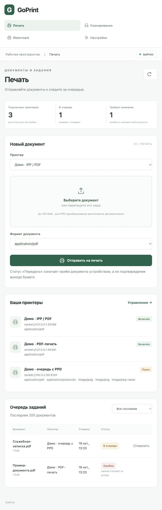

# GoPrint · Инструкция пользователя

Версия v0.1.0-alpha.1 · 19 октября 2026 г.

Автор: Кислов Роман Сергеевич. Apache 2.0.

Руководство для оператора печати и сканирования. Скриншоты сделаны на демонстрационном стенде; названия, адреса и документы служат примерами. Это предварительная версия: фактическую совместимость принтеров проверяет администратор.

## 1. Вход

Получите у администратора адрес GoPrint и токен доступа. На самом сервере стандартный адрес — http://127.0.0.1:8631. Для работы с другого компьютера используйте выданный HTTPS-адрес: localhost на вашем компьютере не указывает на удалённый сервер.

Откройте адрес, вставьте токен в поле «Токен администратора» и нажмите «Войти в GoPrint». Сессия действует 8 часов. Токен не сохраняется в хранилище браузера. Не передавайте его другим людям и не включайте в скриншоты.

Если войти не удалось, проверьте адрес, отсутствие лишних символов в токене и уточните у администратора, не был ли токен заменён. При предупреждении о сертификате попросите администратора исправить подключение.

В этой версии все пользователи входят как один local-admin и имеют доступ к общим заданиям и настройкам. Отдельных личных кабинетов и ролей пока нет. Используйте доступ только в согласованной с администратором группе операторов.

## 2. Отправка документа

1. Откройте «Печать» в левом меню.
2. В блоке «Новый документ» выберите нужный принтер.
3. Нажмите «Выберите документ» или перетащите файл в область загрузки.
4. Выберите MIME-формат, соответствующий файлу: для PDF — application/pdf, для JPEG — image/jpeg, для PNG — image/png.
5. Нажмите «Отправить на печать» и дождитесь сообщения о добавлении в очередь.

Максимальный размер файла — 100 МиБ. Для первого испытания используйте небольшой PDF. DOCX/XLSX и другие офисные документы сначала экспортируйте в PDF. Изменение расширения файла не преобразует содержимое.

Если администратор выбрал PPD, нужное преобразование выполняется автоматически. Без PPD файл должен поддерживаться самим устройством. При включённой обязательной маркировке разрешён только PDF; watermark добавляется автоматически. Выбор числа копий, бумаги и дуплекса в форме пока недоступен.

Принтер с отметкой «Пауза» принимает задания в очередь, но не отправляет их до возобновления. Не отправляйте один документ многократно, если он не вышел сразу.

## 3. Проверка и отмена задания

Внизу раздела «Печать» находится очередь последних 200 документов. Сравните название документа, принтер и время. При необходимости нажмите «Обновить» или выберите фильтр состояний. Интерфейс также обновляется автоматически.

«В очереди» — документ ожидает. Можно нажать «Отменить» в строке задания. Если кнопка исчезла, обработка уже началась; отмена отправленного документа через GoPrint пока недоступна.

«Отправляется» — сервер подготавливает или передаёт документ. Дождитесь результата; не загружайте дубликат.

«Передано» — устройство приняло данные. Это не подтверждение выхода бумаги. Проверьте лоток, наличие бумаги, тонера и сообщения на панели принтера.

«Ошибка» — обработка или передача не удалась. Под статусом отображается причина. На демонстрационном скриншоте показана ошибка подключения к тестовому адресу; это пример диагностики, а не проверка физического принтера.

«Проверьте устройство» — результат передачи неизвестен, например после прерывания связи. Проверьте очередь и выходной лоток устройства вместе с администратором до повторной отправки.

«Отменено» — ожидающее задание отменено. Повторной автоматической отправки нет. Для обращения к администратору сообщите название, время, принтер и текст ошибки; сам конфиденциальный документ отправлять не нужно.

## 4. Запуск сканирования из браузера

1. Положите оригинал на стекло или в автоподатчик МФУ.
2. Откройте «Сканирование» и выберите устройство.
3. Выберите источник: «Стекло» или «Автоподатчик».
4. Выберите 150, 300 или 600 dpi и JPEG либо PDF.
5. Нажмите «Начать сканирование» и дождитесь готовности во «Входящих документах».
6. Нажмите «Скачать» и проверьте полученный файл.

Удалённый запуск работает с предварительно настроенным eSCL/AirScan-устройством. Режим рассчитан на A4 в цвете RGB. Если устройство не поддерживает выбранный источник, разрешение или формат, обратитесь к администратору. Не запускайте второй сеанс на занятом сканере.

Несколько полученных файлов скачиваются ZIP-архивом: распакуйте его, чтобы открыть страницы. Лимиты сеанса — 99 страниц, 100 МиБ и 3 минуты. При ошибке проверьте бумагу, крышку, автоподатчик и сообщения МФУ, затем согласуйте повтор с администратором.

## 5. Отправка скана с панели МФУ

Администратор заранее настраивает на МФУ назначение HTTPS WebDAV, связанное с GoPrint. Название назначения зависит от модели и настроек устройства.

1. Загрузите оригиналы.
2. Выберите настроенное назначение GoPrint на панели МФУ.
3. Укажите параметры сканирования на устройстве и отправьте документ.
4. В браузере откройте «Сканирование → Входящие документы».
5. Нажмите «Обновить», найдите файл по названию и времени, затем «Скачать».

Скриншот предыдущего раздела показывает документ example.pdf, фактически принятый демонстрационным сервером через WebDAV. Это проверка приёма файла; совместимость вашей модели МФУ проверяет администратор отдельно.

Не меняйте адрес и пароль назначения без администратора. Если документ не появился, проверьте результат отправки на МФУ и сообщите время попытки. Файлы доступны общей учётной записи; отдельного распределения сканов по пользователям пока нет.

## 6. Маркировка, помощь и выход

Если включён watermark, GoPrint наносит установленный администратором текст на каждую страницу PDF. В нём могут появляться пользователь, ID задания и дата UTC. Пользовательской настройки маркировки для отдельного задания нет. Если маркировка не может быть нанесена, отправка блокируется.

Разделы «Настройки» и «Watermark» предназначены для администратора. Не изменяйте их при обычной печати и сканировании: изменения действуют на общую систему, включая ожидающие задания.

Если соединение потеряно, сначала обновите страницу. После окончания сессии войдите снова. При отсутствии принтера или сканера попросите администратора зарегистрировать устройство. Если очередь приостановлена, дождитесь её возобновления. При неоднозначном результате печати проверьте устройство перед повтором.

По завершении нажмите «Выйти из аккаунта» внизу левого меню. На общем компьютере дополнительно закройте вкладку и заберите сохранённые документы из каталога загрузок согласно правилам вашей организации.
